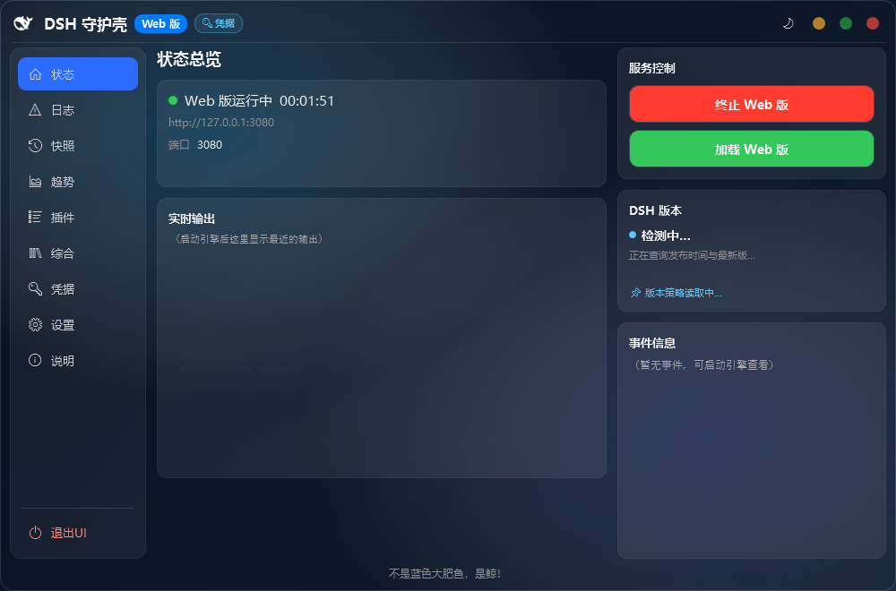
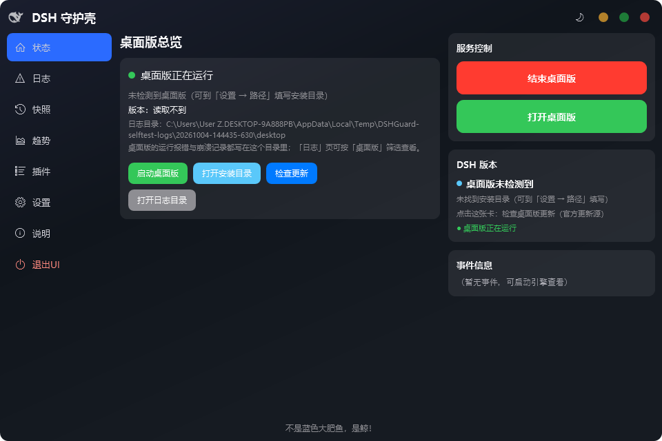
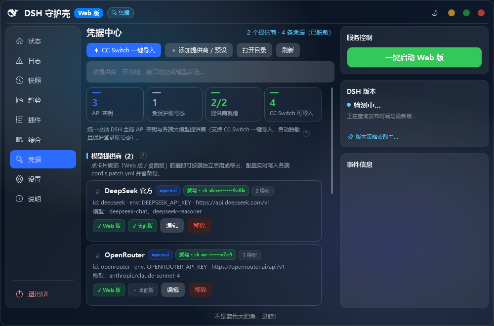
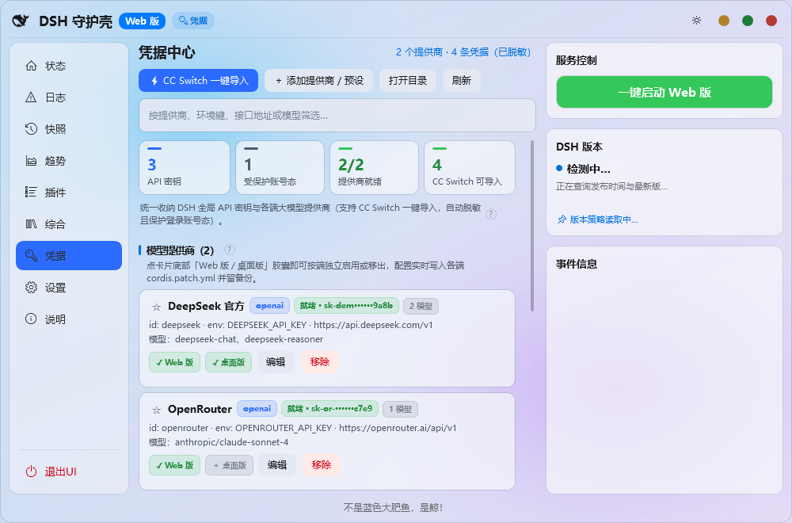
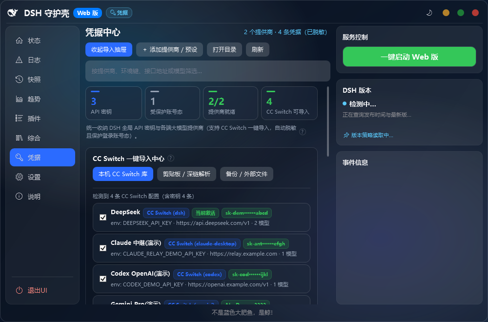
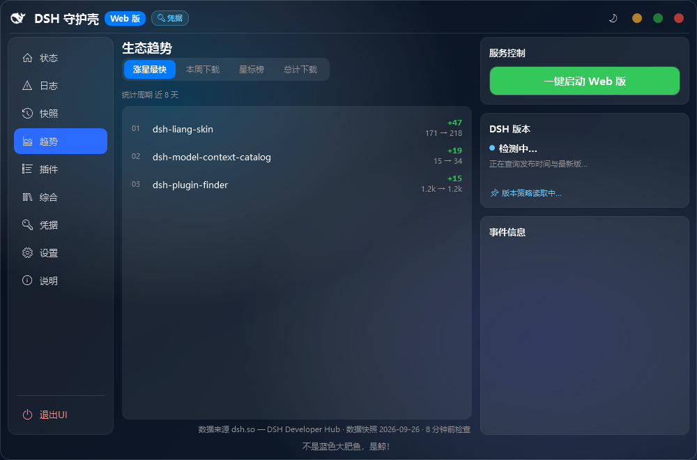

<div align="center">


# DSHGuard（DSH 守护壳）

**Out-of-Band Windows Supervisor, Web/Desktop Dual-Track Manager & Credential Vault for DeepSeek Harness (DSH)**

[简体中文](README.md) ｜ **English** ｜ [Companion Plugin `dsh-guard`](packages/dsh-guard/README.en.md) ｜ [Release Notes](RELEASE-NOTES.md)

[](https://github.com/gluztm/DSHGuard/releases/latest)
[](https://github.com/gluztm/DSHGuard/releases/latest)
[](#why-an-out-of-band-supervisor--companion-plugin)
[](#contributing)
[](LICENSE)

<br />

**[📥 Download Latest Windows Installer (.exe · Non-Admin)](https://github.com/gluztm/DSHGuard/releases/latest)**
&nbsp;&nbsp;·&nbsp;&nbsp;
**[🧩 Install Companion DSH Plugin `dsh-guard`](packages/dsh-guard/README.en.md)**
<br />
<sub>Latest stable installer on Releases is <b>2.3.4</b>; <b>2.4.0</b> (Credential Vault · CC Switch Import · Frontend Overhaul) is live on <code>main</code> for dogfooding, installer coming soon.</sub>

</div>

---

**DSHGuard** is a Windows desktop guard shell（守护壳）designed for both the **DeepSeek Harness (DSH) Web Engine** and the **Official Electron Desktop App**. It snapshots configurations and plugins before every change, recovers broken startups from outside the DSH process, browses and manages 10,700+ community plugins locally, and provides a 2.4.0 Credential & Provider Vault with multi-source CC Switch import — all through a zero-CLI graphical interface.

> [!NOTE]
> **Language Notice**: The desktop application's UI is **Chinese-only** (no localization layer exists today, and self-tests explicitly verify Chinese copy boundaries). This README maps every English concept directly to the Chinese labels you will see on screen.

---

## Why an Out-of-Band Supervisor + Companion Plugin?

Users occasionally ask why **DSHGuard** ships as a standalone Windows `.exe` instead of living solely inside DSH as a plugin. Being **out-of-band** is its superpower — and pairing it with the in-repo companion plugin [`packages/dsh-guard`](packages/dsh-guard/README.en.md) bridges both worlds:

| Scenario | Typical In-Process DSH Plugin | DSHGuard (`.exe`) + Companion [`dsh-guard`](packages/dsh-guard/README.en.md) |
| --- | --- | --- |
| **Broken `cordis.patch.yml` or bad plugin prevents DSH from booting** | Dies with the DSH host; no UI left to recover | **Lives outside the engine**: inspect startup failure tail logs, auto-repair broken links/YAML (after backup), roll back snapshots, or revert pinned DSH versions |
| **Managing both Web & Official Desktop tracks** | Official CLI refuses to manage `desktop` profile; plugins only see one track | **Click the top-left whale icon** (animated transition & whale-call audio) to switch between Web (blue badge) and Desktop (green badge); independent manifests, pnpm execution, and snapshots |
| **API Keys, Providers & CC Switch migration** | Hand-editing `.credentials.yaml` and multi-layer `cordis.patch.yml` | **2.4.0 Credential Vault**: masked secret display, read-only protection for logged-in account blobs, 8 built-in presets + `/models` probe, and multi-source CC Switch import (`cc-switch.db`, `ccswitch://`, clipboard, backup files) |
| **In-chat health check without switching windows** | Requires leaving chat or running manual shell checks | Install companion plugin [`dsh-guard`](packages/dsh-guard/README.en.md) for `/guard` & `dsh_guard_*` read-only tools right inside DSH chat, and spawn DSHGuard only when needed |
| **Unstable GitHub connectivity** | Silent timeouts during catalog fetch or git-based plugin installs | **Single centralized GitHub route table** (Auto / Mirror-first / Direct only) with per-command temporary git URL rewrite that never touches your global git config |

---

## What's Inside (9 Pages · `Ctrl+1` ~ `Ctrl+9`)

In **2.4.0**, the frontend was overhauled onto a unified Oceanic Slate semantic design system (`Tokens.Dark/Light` + `Primitives.xaml` + unified segmented pill tracks and rounded inputs), paired with a standalone **Credentials（凭据）** hub, a header **🔑 凭据 (Credentials)** quick pill, keyboard shortcuts `Ctrl+1`–`Ctrl+9` (switch pages) and `Ctrl+F` (focus page search):

| Shortcut | Page | What it covers |
| --- | --- | --- |
| `Ctrl+1` | **Status（状态）** | Running state, bound port, live output, Desktop home dashboard, right-hand service controls & DSH version card |
| `Ctrl+2` | **Logs（日志）** | Live session feed, per-target historical error/startup logs, copy log, and one-click **Export Diagnostics（导出诊断）** `.zip` |
| `Ctrl+3` | **Snapshots（快照）** | Pre-change auto archives & manual checkpoints, per-item selective rollback, optional DSH version & plugin restore; never touches `.credentials.yaml` |
| `Ctrl+4` | **Trends（趋势）** | Four community leaderboards from `dsh.so`: Rising Stars, Weekly Downloads, Total Stars, and All-Time Downloads |
| `Ctrl+5` | **Plugins（插件）** | **Local Plugins（本地插件）**: search, sort (install/create/update/compatibility), per-plugin historical version picker, batch actions, **Update All（一键更新 N 个）**. **Find Plugins（寻找插件）**: 10,700+ community index with Ctrl+wheel cursor-anchored lightbox |
| `Ctrl+6` | **Unified（综合）** | **2.4.0 5-Tab Hub**: **Plugins（插件）**, **MCP**, **Skills**, **Prompts（提示词）**, and **Sessions（会话）** |
| `Ctrl+7` | **Credentials（凭据）** | **2.4.0 Dedicated Hub**: masked `.credentials.yaml` vault, protected account state blobs, per-track provider toggles, 8 presets + `/models` probe, and multi-source CC Switch importer |
| `Ctrl+8` | **Settings（设置）** | **General（常规）** + GitHub route mode; **Paths（路径）** + one-click **Auto-Configure（自动配置）**; **Version（版本）** pinning & rollback; **Advanced（高级）** mirrors & snapshot limits |
| `Ctrl+9` | **About（说明）** | Quick folder shortcuts, FAQ, current version badge, and contributors (`@gluztm`, `@gemini-code-assist`, `@deepseek-ai`, Claude, ChatGPT, GLM) |

---

## Screenshots (2.4.0)

<table>
  <tr>
    <td width="50%" align="center">
      <br />
      <sub><b>Status（状态）</b> · Dual-track Web/Desktop control & quick 凭据 pill</sub>
    </td>
    <td width="50%" align="center">
      <br />
      <sub><b>Desktop Track（桌面版）</b> · Independent overview, version check & launch controls</sub>
    </td>
  </tr>
  <tr>
    <td width="50%" align="center">
      <br />
      <sub><b>Credentials（凭据 · Dark）</b> · Masked secrets & Web/Desktop per-track provider toggles</sub>
    </td>
    <td width="50%" align="center">
      <br />
      <sub><b>Credentials（凭据 · Light）</b> · Symmetric dark/light semantic tokens</sub>
    </td>
  </tr>
  <tr>
    <td width="50%" align="center">
      <br />
      <sub><b>CC Switch Importer</b> · Read-only <code>cc-switch.db</code> via <code>winsqlite3.dll</code>, <code>ccswitch://</code> links, clipboard & files</sub>
    </td>
    <td width="50%" align="center">
      <br />
      <sub><b>Trends（生态趋势）</b> · Community leaderboards & built-in plugin marketplace</sub>
    </td>
  </tr>
</table>

---

## Requirements & Install

- **OS**: Windows 10 or 11 (64-bit)
- **Runtime**: Node.js LTS (the installer offers per-user non-admin setup automatically if missing)
- **Optional**: `pnpm` (required for Desktop track plugins or pnpm-based plugins), `Git` (required only for Git-hosted plugins)
- **Building from source**: requires **.NET 10 SDK**

### Option A: Windows Installer (Recommended)

1. Download the latest `DSHGuard-Setup-<version>.exe` from **[GitHub Releases](https://github.com/gluztm/DSHGuard/releases/latest)** and verify its SHA256 checksum (see [SECURITY.md](SECURITY.md)).
2. Run the wizard — installs per-user under `%LOCALAPPDATA%\Programs\DSHGuard` with **zero administrator rights required**.
3. Launch DSHGuard and click **一键启动 Web 版** (Start Web) or **启动桌面版** (Start Desktop). Exiting the UI via **退出UI** or closing to the tray does **not** stop a running engine; use **终止 Web 版 / 结束桌面版** when you truly want to stop it.

### Option B: Companion DSH Plugin (`packages/dsh-guard`)

```powershell
# Add directly to a DSH Web profile:
dsh plugin --profile web add https://github.com/gluztm/DSHGuard.git#main:packages/dsh-guard

# Or run the standalone read-only CLI (Node.js >= 18):
node packages/dsh-guard/bin/dsh-guard.mjs status
```

---

## Design Decisions & Safety Boundaries

- **Supervise, don't take over**: DSHGuard respects an already-running external engine and checks port ownership before launching.
- **Minimal touch on `%USERPROFILE%\.dsh`**: treated as read-only by default. Automatic repair only triggers when backed-up startup blockers are found (`cordis.patch.yml` invalid syntax, malformed package entry, or stale links created by DSHGuard itself). Uninstalling DSHGuard (both data-preserving and full-cleanup modes) never touches `%USERPROFILE%\.dsh`.
- **Masked credentials & protected account blobs**: `.credentials.yaml` secret values stay masked in UI and logs, and non-API login state blocks are marked read-only so provider edits never corrupt existing DSH logins.
- **Per-track strict scoping**: snapshots remember whether they belong to `web` or `desktop`; rolling back a snapshot always restores to the snapshot's own target regardless of the current header toggle.

---

## Contributing

Bug reports (please attach the `.zip` from **日志 → 导出诊断** via our [Bug Issue Form](.github/ISSUE_TEMPLATE/bug_report.yml)), feature ideas, and pull requests are all welcome! See [CONTRIBUTING.md](CONTRIBUTING.md) for the full Chinese developer guide.

If **DSHGuard** saves you time, a **Star** ⭐ on GitHub helps others in the DSH ecosystem discover it!

```powershell
# Gates, single-file Release publish (0 warnings/errors gate), SelfTest & companion test:
powershell -NoProfile -ExecutionPolicy Bypass -File tools\check-target-hygiene.ps1
powershell -NoProfile -ExecutionPolicy Bypass -File tools\check-wiring-gate.ps1
dotnet publish DSHGuard.csproj -c Release -r win-x64
bin\Release\net10.0-windows\win-x64\publish\DSHGuard.exe --selftest
node packages/dsh-guard/test/smoke.mjs

# Build Inno Setup 6 installer (dist\):
powershell -NoProfile -ExecutionPolicy Bypass -File installer\build-installer.ps1
```

---

## Contributors & License

Full attribution notes in [CONTRIBUTORS.md](CONTRIBUTORS.md): **[gluztm](https://github.com/gluztm)**, **[Gemini](https://github.com/gemini-code-assist)**, **[deepseek-ai](https://github.com/deepseek-ai)**, **Claude**, **ChatGPT**, **GLM**.

Released under the **GNU GPL v3** license — see [LICENSE](LICENSE).

```text
Copyright (c) 2026 DSHGuard contributors
```
