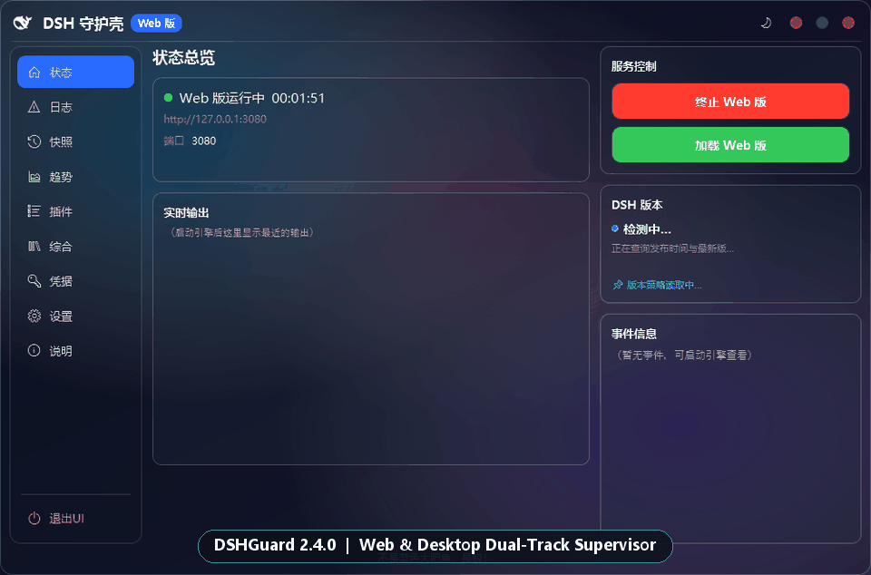
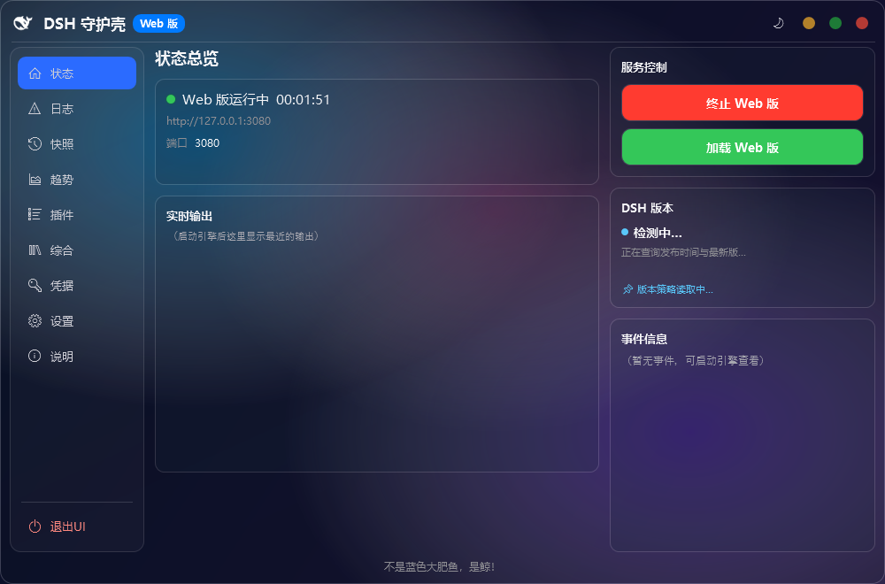
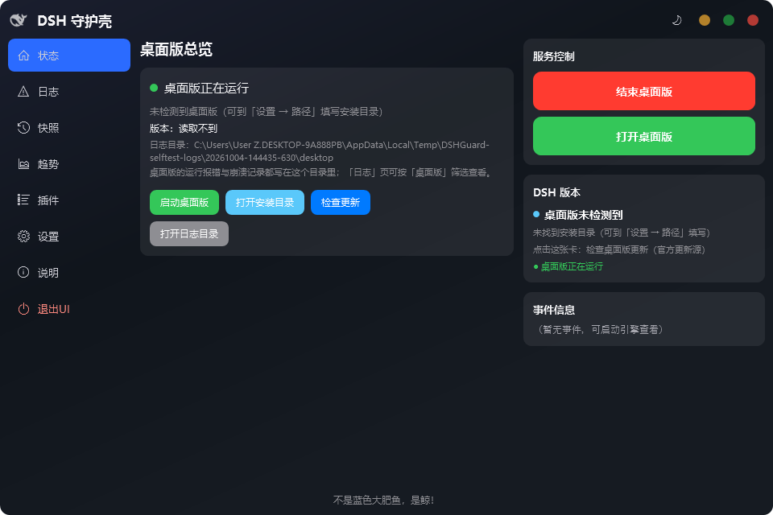
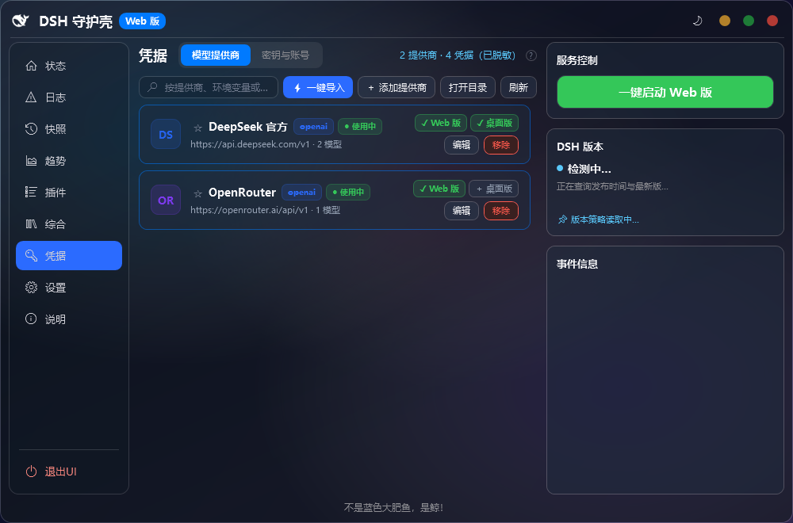
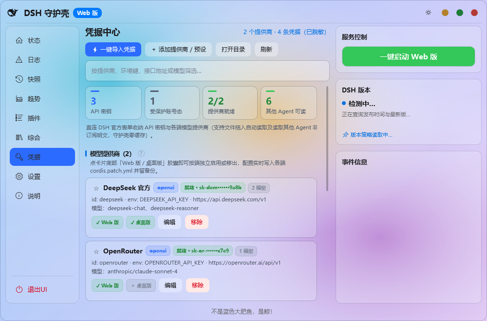
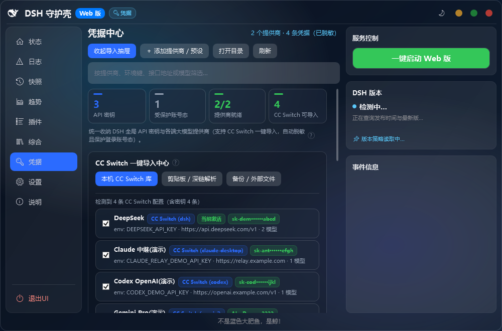
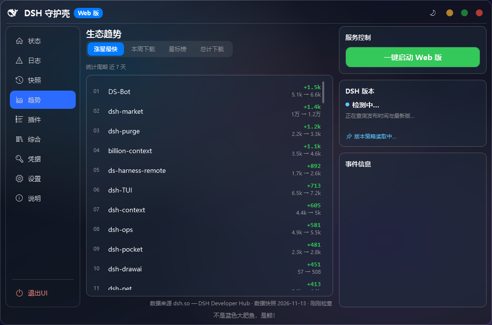

<div align="center">


# DSHGuard（DSH 守护壳）

**Standalone Windows Launcher, Crash Recovery, Web/Desktop Plugin Manager & API Key Tool for DeepSeek Harness (DSH)**

[简体中文](README.md) ｜ **English** ｜ [Companion Plugin `@gluztm/dsh-guard`](packages/dsh-guard/README.en.md) ｜ [Release Notes](RELEASE-NOTES.md)

[](https://github.com/gluztm/DSHGuard/releases/latest)
[](https://github.com/gluztm/DSHGuard/releases/latest)
[](#why-use-an-out-of-band-launcher--companion-plugin)
[](#contributing)
[](LICENSE)

<br />

**[Download Windows Installer (2.4.2 · Non-Admin)](https://github.com/gluztm/DSHGuard/releases/latest)**
&nbsp;&nbsp;·&nbsp;&nbsp;
**[Install Companion DSH Plugin `@gluztm/dsh-guard`](packages/dsh-guard/README.en.md)**
<br />
<sub><b>2.4.2 Release</b>: ships cross-platform companion plugin `@gluztm/dsh-guard` (plugin/MCP switches, broken symlink repair, one-way `.credentials.yaml` writes, SHA256 snapshot rollback) alongside the Windows out-of-process recovery launcher and credential importer.</sub>

</div>

---

**DSHGuard** gives you a single desktop window on Windows to start, monitor, and repair both the **DeepSeek Harness (DSH) Web Engine** and the **Official Electron Desktop App**. It snapshots config files before changes, recovers broken startups when DSH itself refuses to boot, manages 10,700+ community plugins locally (including the `desktop` profile), and lets you configure `.credentials.yaml` providers or import plaintext keys from local agents without touching a terminal.

> [!NOTE]
> **UI Language**: The desktop app interface is currently Chinese-only (the test suite asserts Chinese UI strings). Every section below keeps the exact on-screen Chinese label next to its English translation.

---

## Why Use an Out-of-Band Launcher + Companion Plugin?

Users often ask why **DSHGuard** runs as a separate Windows `.exe` rather than only as a plugin inside DSH. Running outside the DSH process matters most when DSH breaks, while the cross-platform [`@gluztm/dsh-guard`](packages/dsh-guard/README.en.md) plugin covers fast day-to-day checks inside DSH:

| Everyday Problem | Why an In-Process Plugin Alone Falls Short | DSHGuard (`.exe`) + Companion [`@gluztm/dsh-guard`](packages/dsh-guard/README.en.md) |
| --- | --- | --- |
| **Broken `cordis.patch.yml` or bad plugin prevents DSH from booting** | In-process plugins fail to load with the host, leaving no UI | **Runs outside the engine**: open DSHGuard anyway, read failure tail logs, fix broken links or YAML (after backup), roll back snapshots, or revert DSH versions |
| **Official CLI rejects `desktop` profile plugin management** | CLI only targets `web`, and plugins see only one side | **Click the top-left whale icon** to toggle between Web (blue badge) and Desktop (green badge); manifests, pnpm installs, and snapshots stay isolated per target |
| **Editing `.credentials.yaml` or migrating keys from other tools** | Hand-editing nested YAML easily breaks startup syntax | **Zero-cache Credentials hub**: auto-append `/v1` or `/v1beta` across 4 protocols, test individual models, drop URL+Key files, or read plaintext non-subscription keys from Claude Code, Codex, and Gemini |
| **Unstable GitHub access hangs plugin installs** | `git` plugin commands hang or time out cleanly without logs | **Centralized GitHub route selector** (Auto / Mirror-first / Direct only) rewrites only timed-out `git` calls per command without modifying global `.gitconfig` |
| **Quick plugin/MCP switches or config backups from inside DSH** | Leaving the chat window adds friction | Install [`@gluztm/dsh-guard`](packages/dsh-guard/README.en.md) on Windows, macOS, or Linux for live Web sidebar controls, `/guard`, and `dsh_guard_*` tools |

DSHGuard watches without taking over: DSH manages its own runtime, detects an already-running external engine, and never hijacks open ports.

---

## What Is Inside (9 Pages · `Ctrl+1` ~ `Ctrl+9`)

Version `2.4.0+` adds a dedicated zero-cache **Credentials（凭据）** view (`Ctrl+7`), dark and light frosted-glass themes, 4-edge drag resizing, and keyboard navigation (`Ctrl+1`–`Ctrl+9` to switch pages, `Ctrl+F` to focus search):

| Shortcut | Page | What It Does |
| --- | --- | --- |
| `Ctrl+1` | **Status（状态）** | Running state, bound port, live output, Desktop home dashboard, start/stop controls & DSH version check |
| `Ctrl+2` | **Logs（日志）** | Live console feed, per-target historical crash logs, copy log, and one-click **Export Diagnostics（导出诊断）** `.zip` |
| `Ctrl+3` | **Snapshots（快照）** | Auto pre-change backups & hourly checkpoints, selective config rollback, optional DSH version & plugin restore; skips `.credentials.yaml` |
| `Ctrl+4` | **Trends（趋势）** | Four `dsh.so` community rankings: Rising Stars, Weekly Downloads, Total Stars, All-Time Downloads |
| `Ctrl+5` | **Plugins（插件）** | **Local Plugins（本地插件）**: search, sort, per-plugin historical version picker, **Update All（一键更新 N 个）**. **Find Plugins（寻找插件）**: 10,700+ index with image zoom |
| `Ctrl+6` | **Unified（综合）** | Manage **Plugins（插件）**, **MCP**, **Skills**, **Prompts（提示词）**, and **Sessions（会话）** in one view |
| `Ctrl+7` | **Credentials（凭据）** | Masked read/write of `.credentials.yaml`, per-track provider toggles, URL+Key file drop & local non-subscription Agent key reader |
| `Ctrl+8` | **Settings（设置）** | **General（常规）** + GitHub routing; **Paths（路径）** + **Auto-Configure（自动配置）**; **Version（版本）** pinning; **Advanced（高级）** mirrors & retention limits |
| `Ctrl+9` | **About（说明）** | Directory shortcuts, troubleshooting FAQ, current version, and contributors (`@gluztm`, `@gemini-code-assist`, `@codex`, `@deepseek-ai`, Claude, ChatGPT, GLM) |

---

## Screenshots (2.4.0 – 2.4.2)

<p align="center">
  <br />
  <sub>Dual-track Web/Desktop control, 4-protocol model configuration, dark/light themes, and multi-source key import</sub>
</p>

<table>
  <tr>
    <td width="50%" align="center">
      <br />
      <sub><b>Status（状态）</b>: Web/Desktop launcher, port ownership & edge-resizable window</sub>
    </td>
    <td width="50%" align="center">
      <br />
      <sub><b>Desktop Track（桌面版）</b>: isolated desktop controls & version check</sub>
    </td>
  </tr>
  <tr>
    <td width="50%" align="center">
      <br />
      <sub><b>Credentials（凭据 · Dark）</b>: 4-protocol suffix helper, thinking options & single-model test</sub>
    </td>
    <td width="50%" align="center">
      <br />
      <sub><b>Credentials（凭据 · Light）</b>: light theme variant with high-contrast labels</sub>
    </td>
  </tr>
  <tr>
    <td width="50%" align="center">
      <br />
      <sub><b>Credential Importer</b>: drop URL+Key files or read plaintext local Agent keys into DSH YAML</sub>
    </td>
    <td width="50%" align="center">
      <br />
      <sub><b>Trends（生态趋势）</b>: community plugin charts & built-in catalog browser</sub>
    </td>
  </tr>
</table>

---

## Requirements & Installation

- **OS**: Windows 10 or 11 (64-bit)
- **Runtime**: Node.js LTS (the installer offers non-admin per-user setup automatically if missing)
- **Optional**: `pnpm` (needed for Desktop track plugins or pnpm packages), `Git` (needed only for Git-hosted plugins)
- **Building from source**: requires **.NET 10 SDK**

### Option A: Windows Installer (Recommended)

1. Download `DSHGuard-Setup-2.4.2.exe` from **[GitHub Releases](https://github.com/gluztm/DSHGuard/releases/latest)** and verify its checksum using `SHA256SUMS-2.4.2.txt` (details in [SECURITY.md](SECURITY.md)).
   - Because open-source releases do not use a commercial EV certificate, Windows SmartScreen may show a prompt on first launch; verify the SHA-256 hash and click **"More info → Run anyway"**.
2. Installs per-user into `%LOCALAPPDATA%\Programs\DSHGuard` with **no administrator prompt**.
3. Open DSHGuard and click **一键启动 Web 版** (Start Web) or **启动桌面版** (Start Desktop). Exiting via **退出UI** or closing to the tray leaves any running DSH engine untouched; use **终止 Web 版 / 结束桌面版** when you actually want to stop it.

### Option B: Cross-Platform Companion Plugin (`@gluztm/dsh-guard`)

```powershell
# Add directly to DSH Web profile (Windows, macOS, or Linux):
dsh plugin --profile web add https://github.com/gluztm/DSHGuard/releases/download/2.4.2/dsh-guard-2.4.2.tgz

# Optionally add to DSH Desktop profile:
dsh plugin --profile desktop add https://github.com/gluztm/DSHGuard/releases/download/2.4.2/dsh-guard-2.4.2.tgz

# Or run the CLI directly (Node.js >= 18):
node packages/dsh-guard/bin/dsh-guard.mjs status
```

---

## Safety Boundaries & Data Handling

- **External-first by default**: checks existing port ownership before launching and treats `%USERPROFILE%\.dsh` as read-only unless you trigger an action or automatic startup repair hits a known blocker (`cordis.patch.yml` syntax error, malformed package entry, or stale DSHGuard-created junction).
- **Masked credentials & protected account blocks**: `.credentials.yaml` secret values stay masked in UI and logs, and non-API login state blocks stay read-only so provider edits do not overwrite active OAuth sessions.
- **Per-track snapshot isolation**: rolling back always restores to the snapshot's own target (`web` or `desktop`) regardless of which track is currently toggled in the top bar.
- **Uninstaller safety**: neither "keep data" nor "clean uninstall" touches `%USERPROFILE%\.dsh`.

---

## Contributing & Self-Test

Bug reports (attach the `.zip` from **日志 → 导出诊断** in the [Bug Issue Form](.github/ISSUE_TEMPLATE/bug_report.yml)), feature requests, and PRs are welcome. See [CONTRIBUTING.md](CONTRIBUTING.md).

```powershell
# Gates, single-file Release build (0 warnings gate), SelfTest & companion test:
powershell -NoProfile -ExecutionPolicy Bypass -File tools\check-target-hygiene.ps1
powershell -NoProfile -ExecutionPolicy Bypass -File tools\check-wiring-gate.ps1
dotnet publish DSHGuard.csproj -c Release -r win-x64
bin\Release\net10.0-windows\win-x64\publish\DSHGuard.exe --selftest
node packages/dsh-guard/test/smoke.mjs

# Build Inno Setup 6 installer (dist\):
powershell -NoProfile -ExecutionPolicy Bypass -File installer\build-installer.ps1
```

---

## Contributors & License

See [CONTRIBUTORS.md](CONTRIBUTORS.md): **[gluztm](https://github.com/gluztm)**, **[Gemini](https://github.com/gemini-code-assist)**, **[Codex](https://github.com/codex)**, **[deepseek-ai](https://github.com/deepseek-ai)**, **Claude**, **ChatGPT**, **GLM**.

Licensed under **GNU GPL v3** — see [LICENSE](LICENSE).

```text
Copyright (c) 2026 DSHGuard contributors
```
