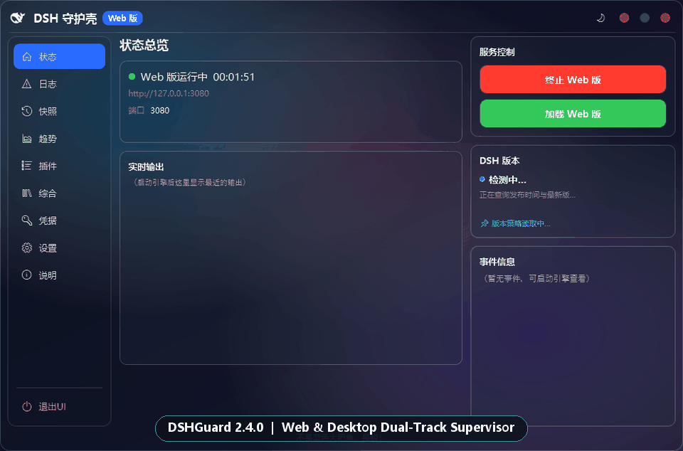
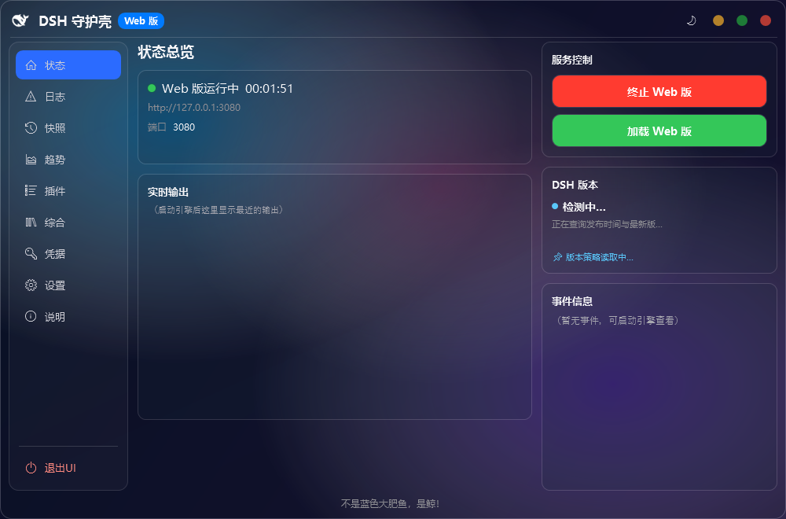
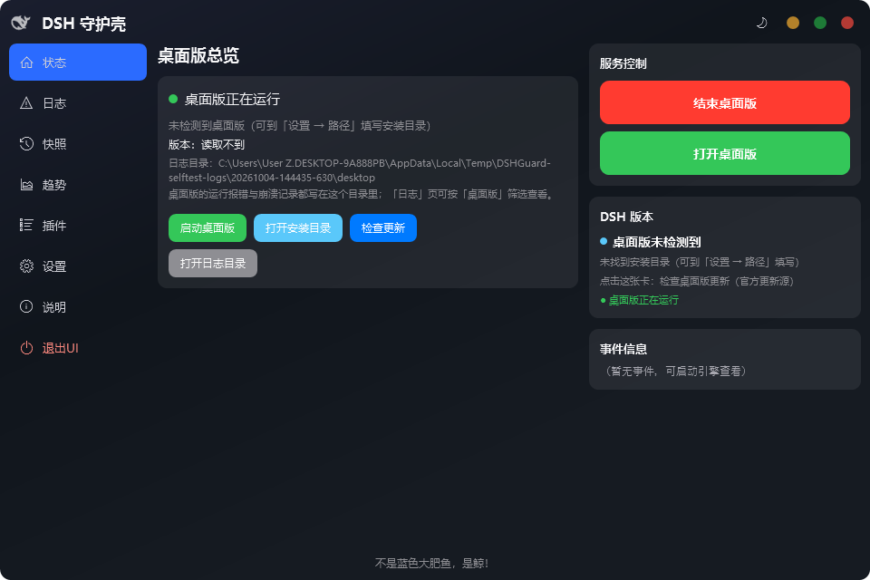
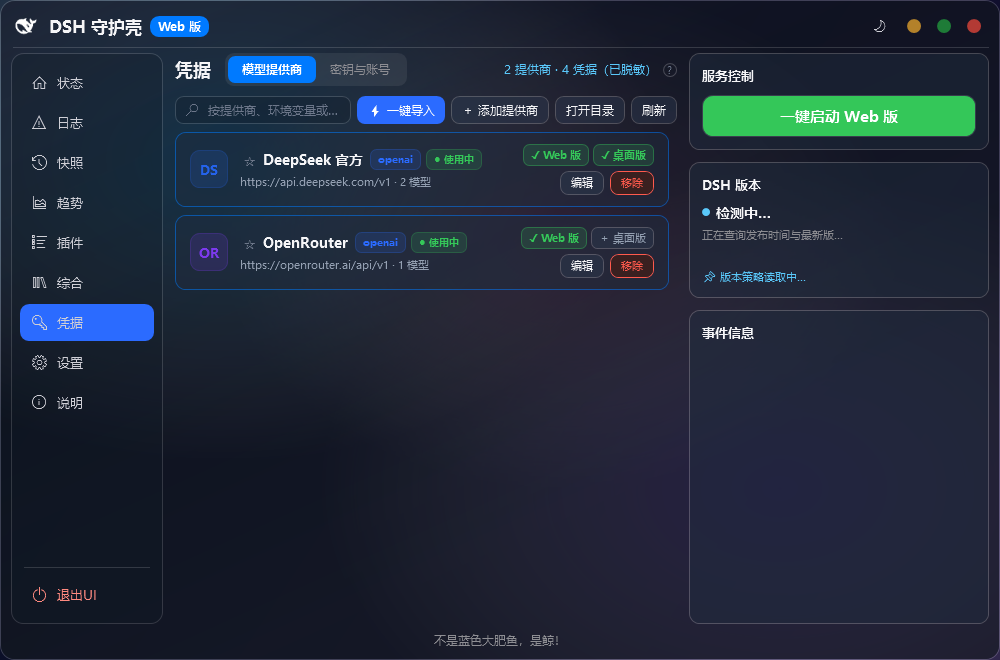
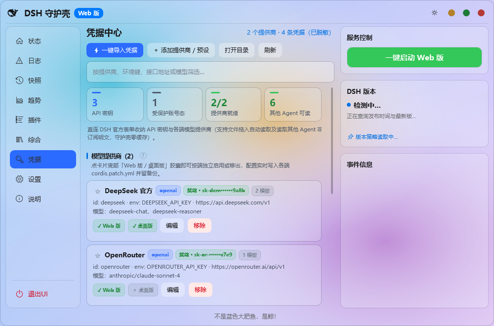
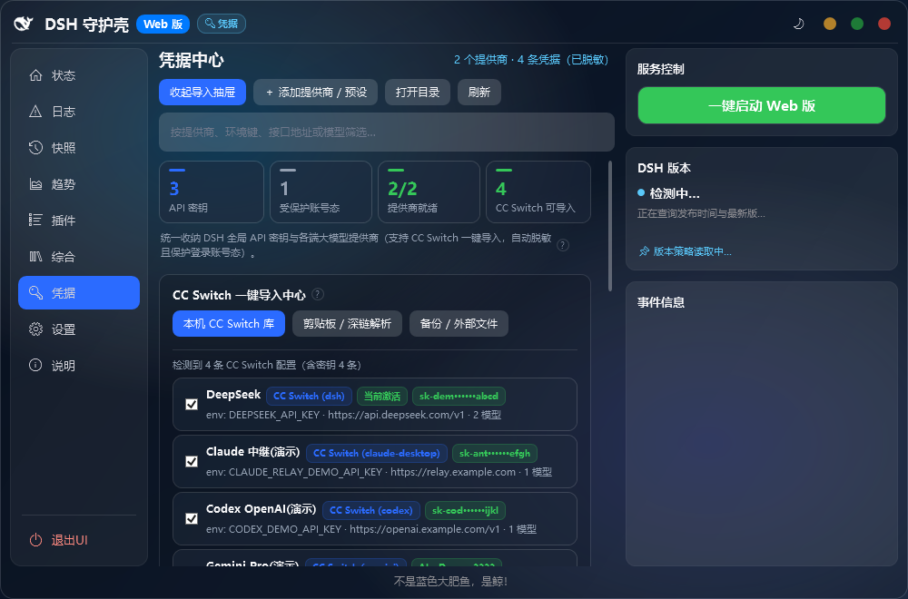
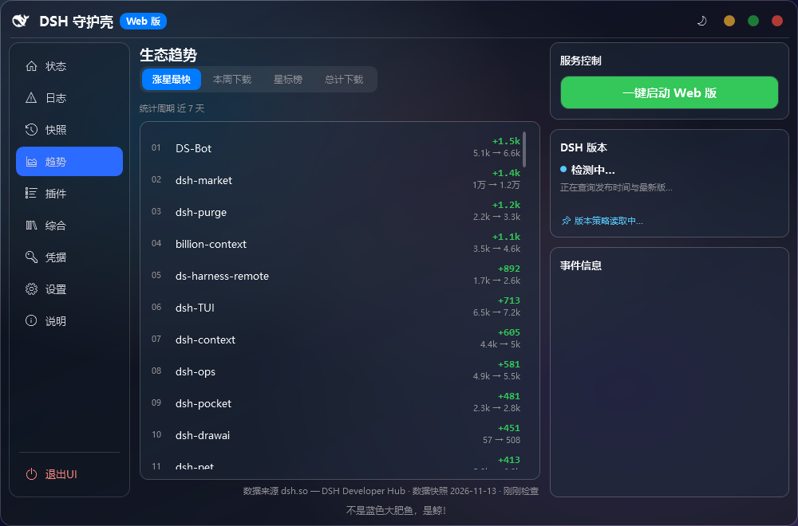
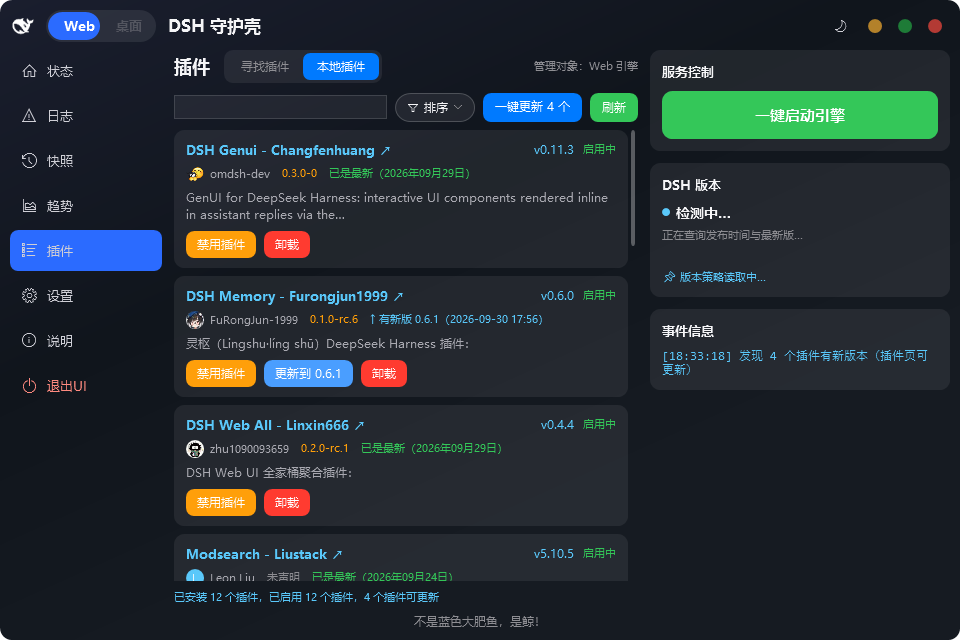
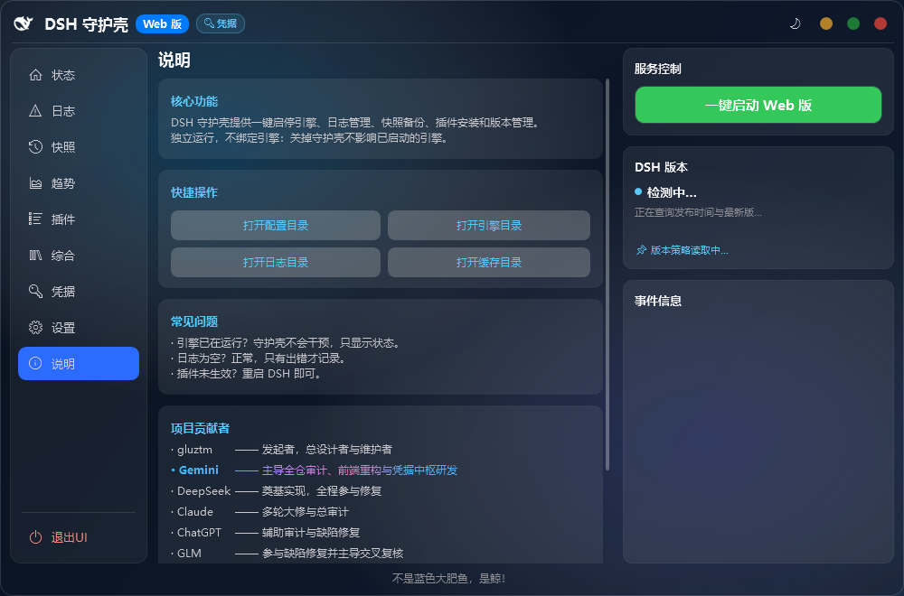

<div align="center">


# DSH 守护壳（DSHGuard）

**DeepSeek Harness（DSH）的 Windows 图形化启动器、启动故障恢复、Web/桌面双端插件与 `.credentials.yaml` 凭据管理工具**

**简体中文** ｜ [English](README.en.md) ｜ [伴生插件 `@gluztm/dsh-guard`](packages/dsh-guard/README.md) ｜ [历代更新说明](RELEASE-NOTES.md) ｜ [推流收录指南](docs/PROMOTION-推流与收录指南.md)

[](https://github.com/gluztm/DSHGuard/releases/latest)
[](https://github.com/gluztm/DSHGuard/releases/latest)
[](#主要解决哪些不方便)
[](#想提交贡献)
[](LICENSE)

<br />

**[下载最新 Windows 安装包（2.4.2 · 免管理员权限）](https://github.com/gluztm/DSHGuard/releases/latest)**
&nbsp;&nbsp;·&nbsp;&nbsp;
**[安装跨平台伴生 DSH 插件 `@gluztm/dsh-guard`](packages/dsh-guard/README.md)**
<br />
<sub><b>2.4.2 正式版</b>：同步内置伴生插件 `@gluztm/dsh-guard`（插件与 MCP 开关、软链接断链修复、`.credentials.yaml` 单向盲写、SHA256 配置对比回滚），Windows 端支持进程外启动排错与多来源 API 密钥导入。</sub>

</div>

---

不想在终端里反复敲命令，或者遇到 DSH 打不开、插件装坏了、端口冲突、`.credentials.yaml` 缩进写错时，可以直接装这个 Windows 图形界面工具。双击打开点右上角即可启停 DSH 网页引擎或官方桌面版；升级翻车或配置改坏后，直接在界面里看失败日志尾部、导出诊断包、按项回滚快照或退回上一版本，并在独立「凭据」页管理 API Key、拖入 URL+Key 文件或读取本机其他 Agent 的非订阅明文凭据。

---

## 主要解决哪些不方便

把高频遇到又难排查的五件事单独拆出来说明，其中独立 `.exe` 与同仓跨平台插件 [`@gluztm/dsh-guard`](packages/dsh-guard/README.md) 各自负责进程外和进程内的部分：

| 日常遇到的问题 | 单独靠进程内插件为什么不够 | DSHGuard（独立窗口）+ `@gluztm/dsh-guard` 的做法 |
| --- | --- | --- |
| **装坏插件或改错 `cordis.patch.yml`，DSH 直接打不开 / 闪退** | 宿主挂了插件面板也打不开，只能翻目录手动改文件 | **独立运行在 DSH 进程之外**：照常打开查看启动失败尾部日志、清理失效联接、一键还原变更前快照，或退回上一稳定版本 |
| **DSH 桌面版（Desktop）怎么装插件？Web 与桌面版目录各管各的** | 官方 CLI 不接管 `desktop` profile，两边配置彼此看不见 | **点左上角鲸鱼图标随时切换目标**：蓝标管理 Web 版、绿标管理官方桌面版；插件清单、快照、下载源和保留配额完全隔离 |
| **手改 `.credentials.yaml` 容易出错，换模型或迁移 API Key 太繁琐** | 手改嵌套 YAML 缩进容易直接启动报错 | **独立零缓存凭据页**：展开卡片直接填模型与协议后缀、单模型测通；支持拖入含 URL+Key 文件或读取本机 Claude Code / Codex / Gemini 非订阅明文密钥，不留缓存副本 |
| **网络连不上 GitHub 时，装 git 插件或刷插件目录一直超时** | 命令卡死直到报错，或者别人教程让改全局 `.gitconfig` 污染本地环境 | **统一入口智能选路**（直连 / 自动兜底 / 镜像优先），只在连接失败时对那一条命令临时改写 Git 地址 |
| **想在 DSH 网页侧边栏随手开关插件、MCP 或备份配置** | 切出窗口操作略麻烦 | 装上跨平台伴生插件 [`@gluztm/dsh-guard`](packages/dsh-guard/README.md)，直接在 **DSH Web 右侧栏**开关插件和 MCP、修软链接、单向填密钥，对话里 `/guard` 就能体检 |

设计上始终遵循**只看护、不接管**：DSH 引擎跑着自己的生命周期；你不打开守护壳时，DSH 也能正常从外部启动运行。

---

## 界面预览 (2.4.0 – 2.4.2)

<p align="center">
  <br />
  <sub>Web / 桌面双轨控制、四协议模型配置、日夜毛玻璃主题与多源导入</sub>
</p>

<table>
  <tr>
    <td width="50%" align="center">
      <br />
      <sub><b>状态页（Web / 桌面双轨）</b>：启停控制、端口归属识别与窗口拖拽缩放</sub>
    </td>
    <td width="50%" align="center">
      <br />
      <sub><b>点鲸鱼切桌面版</b>：绿标指示桌面端目标、版本检测与独立三态开关</sub>
    </td>
  </tr>
  <tr>
    <td width="50%" align="center">
      <br />
      <sub><b>凭据与提供商页（深色）</b>：四协议自动补后缀、推理参数及单模型测通</sub>
    </td>
    <td width="50%" align="center">
      <br />
      <sub><b>凭据与提供商页（浅色）</b>：高对比浅色界面主题</sub>
    </td>
  </tr>
  <tr>
    <td width="50%" align="center">
      <br />
      <sub><b>凭据导入</b>：拖入 URL+Key 文件或读取本机 Agent 非订阅明文，直写官方 YAML</sub>
    </td>
    <td width="50%" align="center">
      <br />
      <sub><b>趋势与社区插件</b>：涨星最快、本周下载、星标榜与 10,700+ 插件收录索引</sub>
    </td>
  </tr>
</table>

---

## 界面布局与快捷键

左侧栏包含九个页面，底部「退出UI」**只关闭窗口、不停止后台 DSH 引擎**；右栏固定显示 **服务控制**、**DSH 版本** 与 **事件信息**；左上角小鲸鱼用来切换 Web / 桌面管理对象，窗口四边与四角可自由拖拽调整大小（最小 `860×560`）。

- **快捷键**：`Ctrl+1` ~ `Ctrl+9` 切换左侧页面；`Ctrl+F` 直接把光标聚焦到当前页面的搜索框。

| 快捷键 | 页面 | 用途 |
| --- | --- | --- |
| `Ctrl+1` | [状态](#一状态页看到引擎在不在跑) | 看运行状态、端口归属、控制台输出；右栏启动、停止或重新打开浏览器 |
| `Ctrl+2` | [日志](#二日志页看清引擎说了什么) | 看实时输出与历史失败日志，按 Web / 桌面筛选，一键复制或「导出诊断」 |
| `Ctrl+3` | [快照](#三快照页改动前存档出事回滚) | 查看改动前自动存档与定时快照，按大类勾选恢复，Web 与桌面版分仓保存 |
| `Ctrl+4` | [趋势](#四趋势页与生态动向) | 来自 `dsh.so` 的四张社区榜单（涨星最快 / 本周下载 / 星标榜 / 总计下载） |
| `Ctrl+5` | [插件](#五插件页本地插件与寻找插件) | 「本地插件」开关、批量更新与指定版本回退；「寻找插件」逛万级社区索引 |
| `Ctrl+6` | [综合](#六综合管理页多端插件mcp-与会话管理) | 在一处统一管理多端插件兼容性、MCP、Skills、提示词与历史会话 |
| `Ctrl+7` | [凭据](#七凭据中心管理密钥与一键导入) | 读取官方 `.credentials.yaml`（默认打码）、切换 Web/桌面模型提供商、拖入文件或从其他 Agent 导入 |
| `Ctrl+8` | [设置](#八设置页常规路径版本高级) | 端口与开机自启、GitHub 选路、自动扫描双端路径、DSH 版本固定与回退、下载源切换 |
| `Ctrl+9` | [说明](#九说明页退出ui-与系统托盘) | 目录快捷入口、常见排障提醒、版本号与贡献者 |

> 历史更新日志（`1.0.0` ~ `2.4.2`）见 [RELEASE-NOTES.md](RELEASE-NOTES.md) 与 [CHANGELOG.md](CHANGELOG.md)。

---

## 各页面具体功能

### 一、状态页：看到引擎在不在跑

在终端启动常要猜端口对不对、进程还在不在、现在到底跑着 Web 还是桌面版。切到状态页就能看清楚。

- **切换管理目标**：点左上角**鲸鱼图标**在「Web 版」（蓝标）与「桌面版」（绿标）之间切换，会记住上次选择。
- **Web 版总览**：显示 **引擎运行中**（含本次运行时长）、**正在启动…** 或 **引擎未运行**，写明访问地址和端口；下方滚动控制台日志；右栏对应「一键启动 Web 版」、运行态的「终止 Web 版 / 加载 Web 版」。
- **桌面版总览**：切到桌面版后展示安装版本、安装目录与日志目录，右栏变为「启动桌面版 / 结束桌面版 + 打开桌面版」以及点击查更新的桌面版「DSH 版本」卡。

注意点：如果外部终端已经在跑 DSH，这里只显示「运行中（外部引擎）」，不会重复启动抢端口。

---

### 二、日志页：看清引擎说了什么

平时窗口闪退一关，报错就看不见了，提 Bug 也不知从哪复制日志。

- 顶部可筛选「全部 / Web 版 / 桌面版」，支持切换到历史失败日志、一键「刷新」「打开目录」「复制日志」。
- **「导出诊断」**：把异常日志、守护壳配置（`settings.json` / `versions.json`，**不包含** DSH `.credentials.yaml`）和系统环境信息打成一个 `.zip`，提 [Issue](.github/ISSUE_TEMPLATE/bug_report.yml) 时直接拖进附件框就行。
- **不留冗余废日志**：正常启动成功时不写失败日志；如果首次失败后自动重试拉起来了，也会自动清掉临时记录。

---

### 三、快照页：改动前存档，出事回滚

装错插件、升级新版本起不来或者配置写乱时，不用自己倒推改过哪些文件。

- 快照严格按目标（「Web 版」/「桌面版」）单独存放与展示。
- 分三档保留配额互不挤占：插件操作前自动存、引擎连续跑满 1 小时自动存、手动「保存当前快照」。
- 右侧可勾选需要恢复的项目，支持一键还原配置，也可随快照恢复 **DSH 版本与当时装过的插件版本**（桌面版按快照记录通过本地 `pnpm` 精准重装）。

安全约束：
- 回滚严格按快照自身记录的目标写回，即使你刚切换过左上角目标，也不会把 Web 快照写进桌面端目录。
- `.credentials.yaml` 等凭据文件绝不参与快照覆盖或自动删除。

---

### 四、趋势页与生态动向

按需从 `dsh.so` 拉取社区数据（带节流与本地缓存，断网也能看上次结果），展示涨星最快、本周下载、星标榜、总计下载四张榜单，点开条目就能跳去仓库或插件页。

---

### 五、插件页：本地插件与寻找插件

分 **「本地插件」** 与 **「寻找插件」** 两个页签（跟随左上角双轨切换）：

- **本地插件**：
  - 支持按名称/作者搜索，按 **安装时间**（默认）、**创建日期**、**更新日期**、**兼容性** 排序，再点同一项即倒序。
  - **指定历史版本回退**：每张卡片右侧的「选择版本」下拉框按需拉取 npm 历史版本与 GitHub Releases 标签，更新踩坑随时退回上一版。
  - 支持单卡启用 / 禁用、更新、卸载，以及多选批量处理和顶部 **「一键更新 N 个」**（更新前自动留快照）。
  - **支持官方桌面版插件管理**：由于官方 CLI 拒绝操作 `desktop` profile，守护壳会在先备份后，直接读写桌面版清单（`dependencies` + `dsh.profile.bundles`）并在桌面版目录执行 `pnpm` 完成装卸。
- **寻找插件**：
  - 索引 10,700+ 社区收录插件，支持分类胶囊、下载/收藏/更新时间、兼容度筛选。
  - 点击缩略图打开内置大图查看器（支持 `Ctrl + 滚轮` 缩放与翻页），已安装过的自动标「已安装」。



---

### 六、综合管理页：多端插件、MCP 与会话管理

按 `Ctrl+6` 进入，把原本分散在不同文件夹里的 DSH 资源配置收在一个页面里检索、开关或编辑：

1. **插件**：跨 Web / 桌面双轨对照检查插件兼容性与清单是否对不上；
2. **MCP**：查看、快捷套用预设新增、编辑、启停和删除各端 MCP 服务；
3. **Skills**：查看与编辑 Agent 技能文件，支持本地新建或从 GitHub 导入；
4. **提示词**：集中管理常用系统提示词；
5. **会话**：搜索历史会话记录、导出 Markdown 摘要或归档清理。

---

### 七、凭据中心：管理密钥与一键导入

按 `Ctrl+7` 打开（界面保持克制，不堆多余入口；实行**零缓存策略**：不在内存或磁盘保留临时 `.bak-cred-*` 密钥副本，确认导入后才写入官方文件）：

- **直读官方 `.credentials.yaml`**：密钥在界面默认严格打码（如 `sk-dem······9a8b`），微信/OAuth 等账号态块锁为只读保护，修改 API Key 绝不覆盖原有账号登录态。
- **按端切换模型提供商**：解析 Web 版与桌面版的 `cordis.patch.yml`，点卡片底部的 **「✓ Web 版 / ✓ 桌面版」** 胶囊就能单独启用或移出某家提供商。
- **8 家常用预设 + `/models` 测通**：内置 DeepSeek 官方、OpenRouter、OpenAI、Anthropic、Gemini、Qwen、StepFun 等常用预设（支持按协议自动补 `/v1` 或 `/v1beta` 后缀），填好就能直接拉取 `/models` 或对单个模型测通。
- **三种零缓存导入方式**：
  1. 拖入或选择包含 URL 和 API Key 的任意文件（纯文本、`.env`、JSON、TOML、YAML、cURL 或只读 `.db`），自动配对并打码预览；
  2. 一键读取本机 Claude Code（`~/.claude`）、Codex（`~/.codex`）、Gemini（`~/.gemini`）、OpenCode、Continue、Aider 中的非订阅明文 API Key（自动跳过 OAuth / 会员订阅登录态）；
  3. 粘贴包含密钥的文本或命令即时提取。关闭抽屉或离开页面后预览立即清空。

---

### 八、设置页：常规、路径、版本、高级

- **常规**：开机自启、引擎就绪自动开浏览器、毛玻璃透明背景开关（远程桌面掉帧可一键关掉）、Web 端口修改（默认 `3080`）、缓存清理，以及 **GitHub 智能选路卡**（自动 / 镜像优先 / 仅直连，仅当直连超时或重置时切备用路线，不掩盖 404）。
- **路径**：手动浏览或用 **「自动配置」** 扫出本机 Web / 桌面版目录、Node 与 `pnpm`（绝不覆盖你手填过的桌面版路径）。
- **版本**：支持 Web 版锁定指定版本或回退上一稳定版（升级前先体检插件兼容度），桌面版检查更新，以及查看守护壳本体新版本检验签名热更新。
- **高级**：分别配置 Web 与桌面端的下载镜像源，以及各档自动快照保留数量。

---

### 九、说明页、退出UI 与系统托盘

- **说明页（`Ctrl+9`）**：常用目录 4 个直达按钮、常见排查提醒、当前版本号与贡献者列表。
- **三个退出行为的区别**：点左下角 **「退出UI」** 只关界面，DSH 引擎仍在运行；点右上角 **关闭按钮 `✕`** 收到系统托盘后台待命；要真正停掉 DSH，用状态页右栏红色 **「终止 Web 版 / 结束桌面版」**。

---

## 下载安装与编译说明

### 方式 1：Windows 安装包（免管理员、免命令行）

1. 到 **[Releases 最新版本页面](https://github.com/gluztm/DSHGuard/releases/latest)** 下载 `DSHGuard-Setup-2.4.2.exe`（页内提供 `SHA256SUMS-2.4.2.txt` 校验值，说明见 [SECURITY.md](SECURITY.md)）。
   - 如果 Windows SmartScreen 弹出「Windows 已保护你的电脑」，点击 **「更多信息 → 仍要运行」** 即可（也可先核对 SHA-256 哈希）。
2. 双击安装（装在当前用户 `%LOCALAPPDATA%\Programs\DSHGuard`，不需要管理员权限；如缺 Node.js 或官方 DSH 桌面版，向导会提供免管理员安装勾选）。
3. 启动后点右上角绿色 **「一键启动 Web 版 / 启动桌面版」**。

### 方式 2：只安装跨平台伴生 DSH 插件 `@gluztm/dsh-guard`

如果人在 Windows / macOS / Linux，只需要侧边栏开关插件与 MCP、修复软链接、单向填密钥与 YAML 配置快照回滚，可以直接装伴生插件：

```powershell
# 安装到 Web 版（或在 DSH 插件市场搜 @gluztm/dsh-guard）
dsh plugin --profile web add https://github.com/gluztm/DSHGuard/releases/download/2.4.2/dsh-guard-2.4.2.tgz

# 安装到桌面版（可选）
dsh plugin --profile desktop add https://github.com/gluztm/DSHGuard/releases/download/2.4.2/dsh-guard-2.4.2.tgz

# 或直接用 Node.js (>=18) 跑 CLI：
node packages/dsh-guard/bin/dsh-guard.mjs status
```

### 方式 3：从源码编译（需要 `.NET 10 SDK`）

- 运行环境：Windows 10 / 11 (x64)、Node.js LTS；管理桌面版或 git 源插件按需准备 `pnpm` / `Git`。

```powershell
dotnet publish -c Release -r win-x64
# 输出单文件可执行程序：bin\Release\net10.0-windows\win-x64\publish\DSHGuard.exe
```

---

## 本地目录、卸载与安全边界

程序数据按以下子目录分放（均可在「设置 → 路径」更改位置）：

| 目录 | 用途 |
| --- | --- |
| `Config` | 守护壳设置、版本记录与 `plugin-times.json`（纯本地存储，不上报） |
| `Cache` | 插件目录与截图缓存（可随时清空，用时自动重下） |
| `Logs` | 异常与启动失败日志（正常启动不落冗余日志） |
| `Snapshots` | Web / 桌面双轨分仓快照 |
| `Tools` | 随包 5 份辅助 PowerShell 脚本（清理日志、查端口、查更新、装 Node/桌面版） |

**最小改动与先备份原则**：
- 默认对 `%USERPROFILE%\.dsh` 只读；卸载程序（无论选「保留数据」还是「彻底卸载」）都**绝不触碰 `%USERPROFILE%\.dsh`**。
- 只在你主动点击插件操作、切换提供商、保存凭据、导入密钥或回滚快照，以及遇到会导致引擎直接崩溃的三类启动坏损（`cordis.patch.yml` 语法错误、包名格式错误、守护壳留下的失效联接）时，才会先写备份再安全修复，并在「事件信息」记录原因。

---

## 常见问题搜索

<details>
<summary><b>1. DSH 启动失败、闪退，或者点启动一直转圈怎么办？</b></summary>

切到「日志」页看最新一份失败日志，里面写明了 DSH 版本、工作目录、启动命令行和最后报错输出。常见原因有首次启动没连网下完依赖缓存，或者 npm 缓存损坏（后者可以在「设置 → 常规 → 清理缓存」处理）。
</details>

<details>
<summary><b>2. 3080 端口被占了，或者跟本地别的程序冲突怎么改？</b></summary>

去「设置 → 常规」改一个空闲端口再点启动即可。如果 DSH 已经从外部终端启动着，守护壳会识别为「运行中（外部引擎）」，不会抢占同一端口。
</details>

<details>
<summary><b>3. DSH 桌面版怎么装插件？为什么装完或启停完插件还没生效？</b></summary>

桌面版目标下由守护壳直接改桌面版清单并用 `pnpm` 安装；任何启停、装卸完成后都需要**重启一次目标端（Web 引擎或 DSH 桌面版）**才能生效，操作结束会弹窗问是否立刻重启。若桌面端缺 `pnpm`，全局装好 `pnpm` 后点一次「设置 → 路径 → 自动配置」复检即可。
</details>

<details>
<summary><b>4. 远程桌面或低配机器上拖动窗口感觉卡顿？</b></summary>

去「设置 → 常规」关掉「毛玻璃背景」，立刻切为纯色实底渲染，拖动和缩放就会流畅很多。
</details>

<details>
<summary><b>5. 提 Bug Issue 需要附带什么文件？怎么防止泄露 Key？</b></summary>

点 **「日志页 → 导出诊断」** 得到 `.zip` 压缩包（导出逻辑主动剔除 `.credentials.yaml`），直接拖到 **[Bug Issue](.github/ISSUE_TEMPLATE/bug_report.yml)** 附件框即可，不要手工粘贴包含密钥的配置文件内容。
</details>

---

## 想提交贡献

欢迎提 Issue 或 PR，测试夹具和贡献规范见 [CONTRIBUTING.md](CONTRIBUTING.md)。如果觉得 **DSHGuard** 省了时间，欢迎点个 **Star** ⭐。

```powershell
# 1. 运行双门禁脚本（目标隔离与随包脚本接线校验）
powershell -NoProfile -ExecutionPolicy Bypass -File tools\check-target-hygiene.ps1
powershell -NoProfile -ExecutionPolicy Bypass -File tools\check-wiring-gate.ps1

# 2. 编译发布版单文件（开启 0 警告门禁）
dotnet publish DSHGuard.csproj -c Release -r win-x64

# 3. 跑全套无头自检（零写盘、不碰宿主机真实 .dsh）
bin\Release\net10.0-windows\win-x64\publish\DSHGuard.exe --selftest

# 4. 跑伴生插件 @gluztm/dsh-guard 沙盒测试
node packages/dsh-guard/test/smoke.mjs

# 5. 打 Inno Setup 6 安装包（输出在 dist\）
powershell -NoProfile -ExecutionPolicy Bypass -File installer\build-installer.ps1
```

<details>
<summary><b>查看源码目录分工</b></summary>

| 路径 | 职责 |
| --- | --- |
| `App.xaml.cs` | 入口、单实例锁与命令行模式分发（`--selftest` / `--shot` / `--dialog-shot` / `--uninstall`） |
| `Frontend/` | 日夜主题颜色令牌、控件样式与命令封装 |
| `Unified/` | 五合一后端管理层：`DshCredentialManager`（脱敏零缓存读写 + 8 套预设）、`DshCcSwitchImporter`（文件拖入与本地 Agent 密钥读取）、MCP/Skills/Prompts/Sessions |
| `MainWindow.*.cs` | 主界面各页签交互与 `MainWindow.Credentials.cs` |
| `ProcessManager.cs` / `DesktopDetector.cs` | Web 引擎进程树管理、端口归属与官方桌面版目录识别 |
| `SnapshotManager.cs` / `VersionMemory.cs` | 自动/手动快照存档、差分还原与版本锁定 |
| `SelfTest.cs` & `SelfTest/` | 结构契约、沙盒测试、门禁与截图测试套件 |
| `packages/dsh-guard/` | 跨平台伴生 DSH 插件 `@gluztm/dsh-guard`（Web 侧边栏、Agent 工具与 CLI） |
| `installer\DSHGuard.iss` | Inno Setup 安装与双模式卸载脚本 |

</details>

---

## 贡献者

完整名单见 [CONTRIBUTORS.md](CONTRIBUTORS.md)。

| 贡献者 | 主要工作 |
| --- | --- |
| [gluztm](https://github.com/gluztm) | 项目发起与长期维护 |
| [Gemini](https://github.com/gemini-code-assist) | 2.3.4–2.4.2 审计门禁、主题语义重构、凭据管理页、导入器与伴生插件设计 |
| [Codex](https://github.com/codex) | 系统架构设计、边界交叉审计与缺陷定位修复 |
| [deepseek-ai](https://github.com/deepseek-ai) | 1.0 基础框架与早期实现 |
| Claude | 2.0 起参与架构与质量审核 |
| ChatGPT | 辅助开发与代码审查 |
| GLM | 缺陷修复与交叉复核 |

<div align="center">
  
</div>

---

## 许可

基于 **GNU GPL v3** 开源，条款见 [`LICENSE`](LICENSE)。

```text
Copyright (c) 2026 DSHGuard contributors
```
