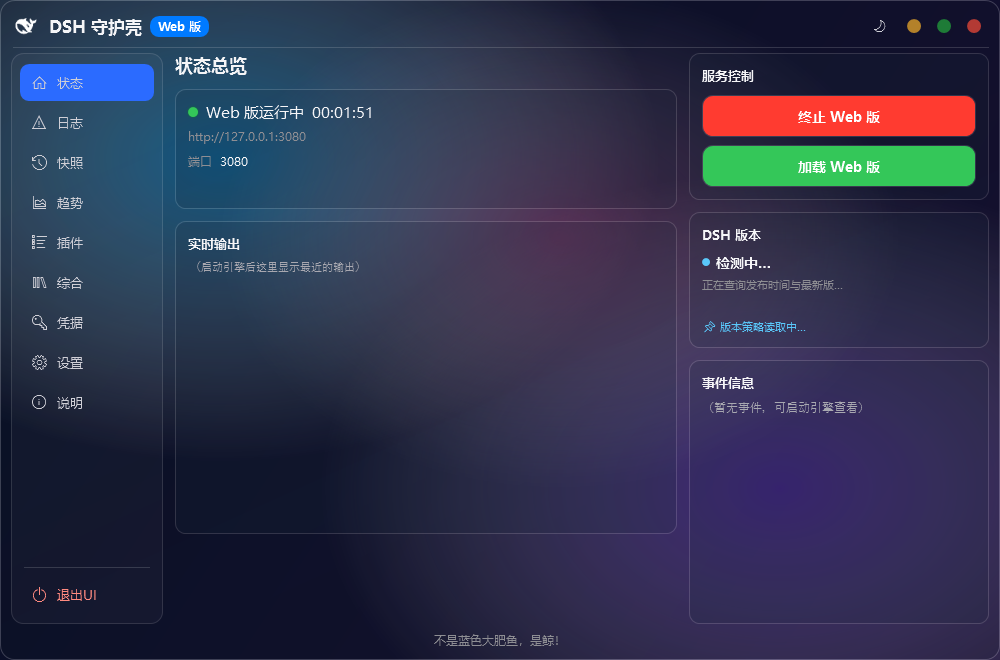
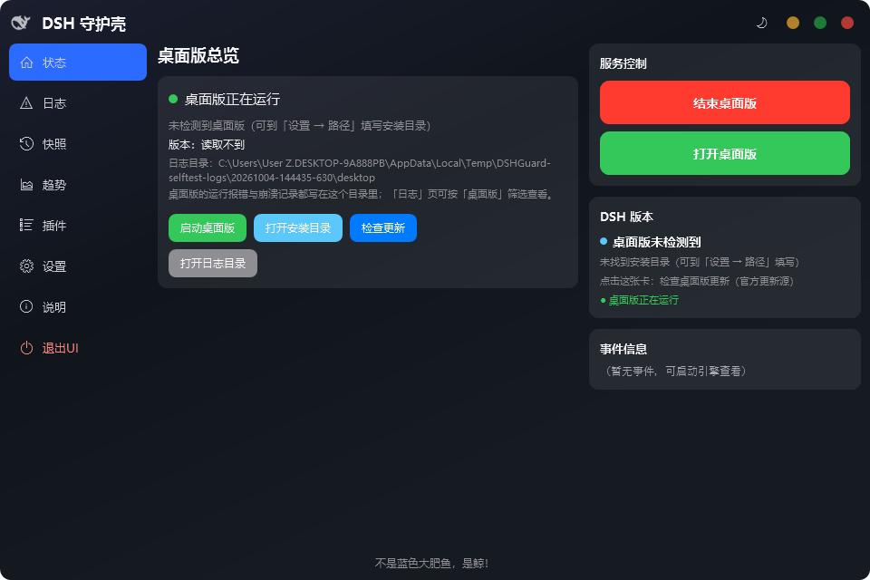
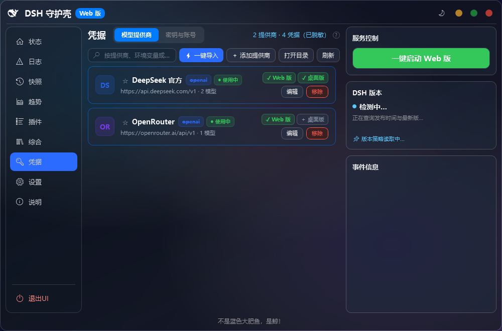
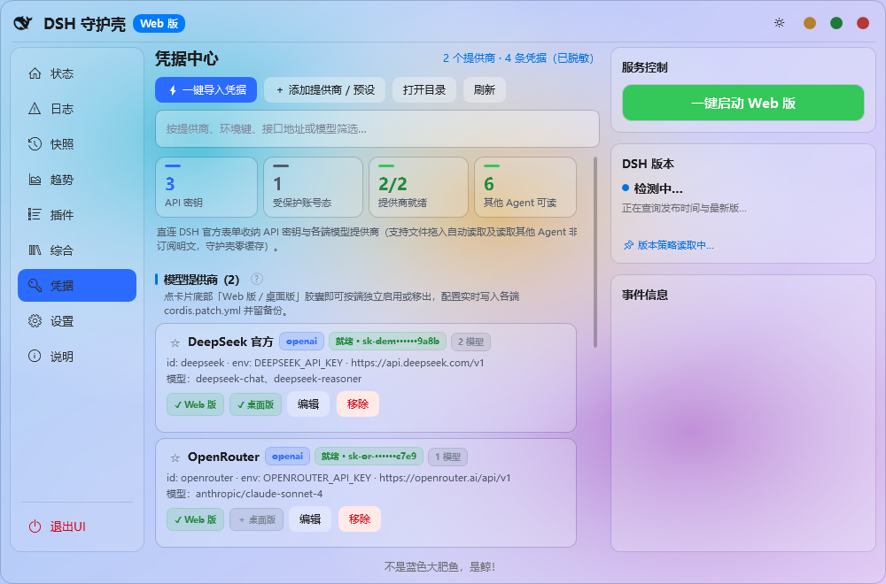
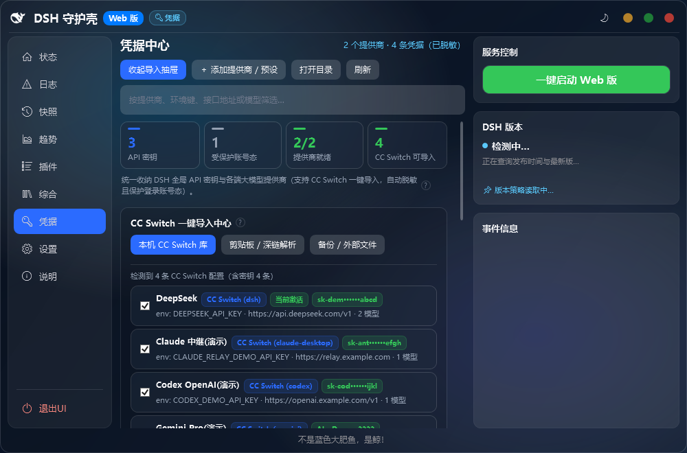
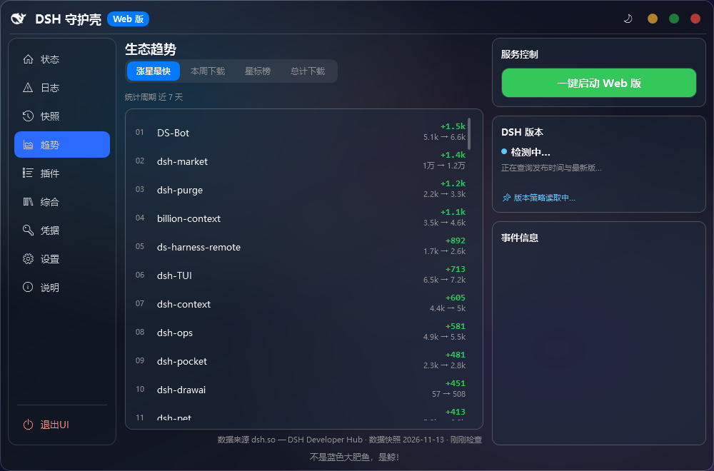
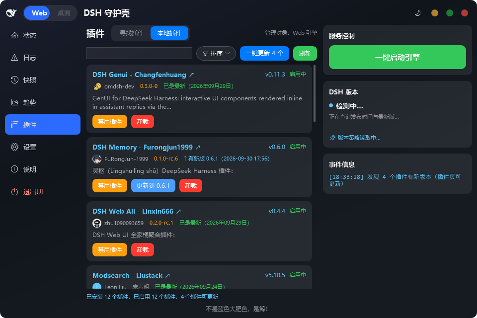
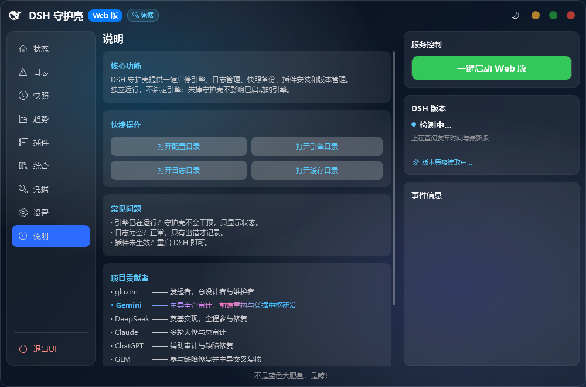

<div align="center">


# DSH 守护壳（DSHGuard）

**DeepSeek Harness（DSH）的 Windows 进程外安全气囊、Web/桌面双轨管家与凭据中枢**

**简体中文** ｜ [English](README.en.md) ｜ [伴生插件 `dsh-guard`](packages/dsh-guard/README.md) ｜ [历代更新说明](RELEASE-NOTES.md) ｜ [推流收录指南](docs/PROMOTION-推流与收录指南.md)

[](https://github.com/gluztm/DSHGuard/releases/latest)
[](https://github.com/gluztm/DSHGuard/releases/latest)
[](#核心定位为什么需要进程外守护壳)
[](#想提交贡献)
[](LICENSE)

<br />

**[📥 下载最新 Windows 安装包（免管理员 · 自带运行环境向导）](https://github.com/gluztm/DSHGuard/releases/latest)**
&nbsp;&nbsp;·&nbsp;&nbsp;
**[🧩 安装官方伴生 DSH 插件 `dsh-guard`](packages/dsh-guard/README.md)**
<br />
<sub>当前 Releases 最新稳定安装包为 <b>2.3.4</b>；<b>2.4.0</b>（独立零缓存凭据中枢 · 文件拖入与 Agent 明文导入 · 高透毛玻璃与四角缩放）已合入 <code>main</code> 先行内测，正式安装包即将发布。</sub>

</div>

---

**面向不折腾命令行的用户与日常重度玩家**：安装后双击打开，点右上角按钮即可一键启停 DSH 网页引擎或官方桌面版；装坏插件、改乱配置、端口冲突或上游更新翻车时，不需要敲一句命令行，在图形界面里即可**看失败现场、导出诊断包、按项回滚快照、切换固定版本**，并在独立的「凭据」功能区中直接管理 DSH 官方表单凭据、拖入 URL+Key 文件或读取本机其他 Agent 的非订阅明文凭据。

---

## 核心定位：为什么需要「进程外守护壳」？

很多人刚见到 DSHGuard 会问：**为什么做成一个独立的 `.exe`，而不是纯 DSH 插件？**
答案恰恰相反——**「活在 DSH 进程之外」正是守护壳不可替代的救命能力；再搭配同仓官方伴生插件 [`packages/dsh-guard`](packages/dsh-guard/README.md)，就构成“内哨探 + 外救援”的双保险：**

| 使用场景 | 传统进程内 DSH 插件 | DSHGuard（进程外守护壳）+ `dsh-guard` 伴生插件 |
| --- | --- | --- |
| **配置写坏 / 插件损坏导致 DSH 起不来** | 随 DSH 宿主一起无法启动，插件面板打不开、无法自救 | **守护壳活在进程外**：照常打开查看启动失败尾部日志、清理失效联接、一键回滚变更前快照或切换回上一长期稳定版 |
| **同时使用 Web 版与官方 Electron 桌面版** | 官方 CLI 拒绝管理桌面版目录；单侧插件只看得见自己这一边 | **点左上角小鲸鱼抛硬币切换**：蓝标「Web 版」与绿标「桌面版」瞬间换边，两套插件、快照、下载源与保留数完全隔离 |
| **API 密钥、模型切换与一键凭据导入** | 手工编辑 `.credentials.yaml` 与多层缩进的 `cordis.patch.yml`，极易写坏 YAML | **独立零缓存凭据中枢**：拖入含 URL+API Key 的任意文件自动解析、一键读取其他 Agent（Claude Code/Codex/Gemini CLI/OpenCode 等）的非订阅明文密钥（自动跳过 OAuth 订阅），不存守护壳缓存或 `.bak-cred` 副本，直写官方表单并保护账号登录态 |
| **找不到新插件 / 不想切回命令行** | 靠朋友口头传包名、手动翻 GitHub | **内置 10,700+ 社区插件市场 + 生态趋势三榜**：浏览器即看大图缩放、按兼容度排序、一键批量更新；装上 [`dsh-guard`](packages/dsh-guard/README.md) 后对话里输入 `/guard` 就能就地巡检并拉起守护壳 |
| **网络环境下访问 GitHub 不稳定** | 安装 git 插件或检查更新静默超时卡死 | **全程序统一单点智能选路**（直连 / 自动兜底 / 镜像优先），仅对“无法连上 GitHub”的命令临时改写单条 git 地址，绝不污染本机 git 配置 |

设计原则始终是**「只做看护，不做接管」**：引擎保持自己的生命周期；你不打开守护壳时引擎也能从外部照常运行，需要救援、插件体检或凭据管理时，守护壳就在那里。

---

## 2.4.0 高清实机画廊

<table>
  <tr>
    <td width="50%" align="center">
      <br />
      <sub><b>状态页（Web / 桌面双轨总控）</b> · 一键启停、端口归属识别与四角自由拖拽缩放</sub>
    </td>
    <td width="50%" align="center">
      <br />
      <sub><b>点鲸鱼切桌面版</b> · 绿标指示当前目标、真实座头鲸鲸鸣音效与独立三态控制</sub>
    </td>
  </tr>
  <tr>
    <td width="50%" align="center">
      <br />
      <sub><b>凭据与提供商中枢（夜间毛玻璃）</b> · 通透磨砂质感、全局 API 密钥脱敏直读与受保护账号态</sub>
    </td>
    <td width="50%" align="center">
      <br />
      <sub><b>凭据与提供商中枢（日间毛玻璃）</b> · 42 枚日夜对称语义色令牌，柔亮通透对比鲜明</sub>
    </td>
  </tr>
  <tr>
    <td width="50%" align="center">
      <br />
      <sub><b>凭据一键导入中心</b> · 拖入 URL+API 文件 / 一键读取本机 Agent 非订阅明文 / 零缓存直写官方表单</sub>
    </td>
    <td width="50%" align="center">
      <br />
      <sub><b>生态趋势三榜 + 10,700+ 插件市场</b> · 涨星最快、本周下载、星标总榜与社区插件一站览尽</sub>
    </td>
  </tr>
</table>

---

## 界面总览与快捷导航

左侧栏收纳九大功能页面，底部是「退出UI」（**只关界面、不杀引擎**）；右栏常驻 **服务控制**、**DSH 版本** 与 **事件信息** 三张卡片；标题栏左侧点小鲸鱼切换目标（配真实座头鲸鲸鸣），右侧提供日夜配色切换与窗口分屏停靠，**四边与四角可直接拖拽自由缩放窗口**（最小 `860×560`）。

- **键盘快捷键（2.4.0 新增）**：`Ctrl+1` ~ `Ctrl+9` 快速切换左侧九大页面；`Ctrl+F` 直接聚焦当前页面的搜索筛选框。

| 快捷键 | 页面 | 管什么 |
| --- | --- | --- |
| `Ctrl+1` | [状态](#一状态页看到引擎在不在跑) | 引擎运行状态、端口归属、实时输出；右栏一键启动、终止与重新打开浏览器 |
| `Ctrl+2` | [日志](#二日志页看清引擎说了什么) | 本次会话实时输出、历史失败日志、`web` / `desktop` 标签筛选、复制与「导出诊断」 |
| `Ctrl+3` | [快照](#三快照页改动前存档出事回滚) | 改动前自动存档与手动存档，支持按项勾选或整份回滚；双轨快照严格分仓存储 |
| `Ctrl+4` | [趋势](#四趋势页与生态动向) | 涨星最快 / 本周下载 / 星标榜 / 总计下载四张社区生态榜，数据来自 `dsh.so` |
| `Ctrl+5` | [插件](#五插件页本地插件与寻找插件) | 「本地插件」启停、批量处理、挑版本重装；「寻找插件」逛社区万级收录与看大图 |
| `Ctrl+6` | [综合](#六综合管理页240-五合一中枢) | **2.4.0 五合一中枢**：插件、MCP、Skills、提示词、会话 |
| `Ctrl+7` | [凭据](#七凭据中心240-独立功能区--零缓存一键导入) | **2.4.0 独立凭据功能区**：官方 `.credentials.yaml` 零缓存直读、按端提供商切换、文件拖入 URL+Key 与 Agent 非订阅明文读取 |
| `Ctrl+8` | [设置](#八设置页常规路径版本高级) | 常规（开关、端口与 GitHub 智能选路）、路径（自动配置双端）、版本固定与回退、高级 |
| `Ctrl+9` | [说明](#九说明页退出ui-与系统托盘) | 常用目录直达、常见问题、当前版本与项目贡献者 |

> 历史版本演进明细（`1.0.0` ~ `2.4.0`）已收纳至 [RELEASE-NOTES.md](RELEASE-NOTES.md) 与 [CHANGELOG.md](CHANGELOG.md)，不再占用首页篇幅。

---

## 功能详解

### 一、状态页：看到引擎在不在跑

**它解决什么痛**：引擎原本要在终端里手动拉起，端口是不是对的、进程还活着没有、桌面版和网页引擎到底哪个在跑，全靠自己猜。

- **双轨随时换边**：点左上角**鲸鱼图标**在「Web 版」（蓝标）与「桌面版」（绿标）之间切换，伴随缩放动效与鲸鸣音效，记忆上次选择。
- **Web 版总览**：顶部显示 **引擎运行中**（含本次运行时长）、**正在启动…** 或 **引擎未运行**，标明访问地址与端口；下方实时滚动控制台输出；右栏提供「一键启动 Web 版」、渐变爬坡进度条、以及运行态的「终止 Web 版 / 加载 Web 版」。
- **桌面版总览**：切到桌面版后，中间换成桌面版总览页（状态、版本、安装目录、日志目录及快捷按钮），右栏切换为桌面版三态服务控制（「启动桌面版」 / 「结束桌面版」+「打开桌面版」）以及点击即可检查更新的桌面版「DSH 版本」卡。

**注意点**：
- 引擎已在别处跑着时，守护壳只显示运行中（外部引擎），**不会重复启动或抢占端口**。
- 「终止引擎」会结束进程并中断正在进行的对话；引擎正托管守护壳本身时，会弹出「只解绑 / 仍然终止」二次确认。

---

### 二、日志页：看清引擎说了什么

**它解决什么痛**：引擎起不来时终端窗口一闪就没了，用户手里没有现场，更不知道把什么发给维护者。

- 顶部标签区分「全部 / Web 版 / 桌面版」，支持切换到历史日志文件、一键「刷新」「打开目录」「复制日志」。
- **「导出诊断」**：把异常与启动日志、守护壳配置（`settings.json` / `versions.json`，不包含 DSH `.credentials.yaml`）与运行环境摘要打包成一个 `.zip` 压缩包并定位保存位置，提 [Issue](.github/ISSUE_TEMPLATE/bug_report.yml) 时直接附上即可。
- **正常启动不留废文件**：只有启动失败或界面卡死超过阈值时才写盘留证；「第一次失败、自动重试成功」时会自动清掉临时失败记录。

---

### 三、快照页：改动前存档，出事回滚

**它解决什么痛**：改插件清单或升级版本后出问题，没有还原点，只能手动翻文件逐步试错。

- 列表按**当前管理目标**（「Web 版」/「桌面版」）独立展示每份快照的时间、类型、说明与可回滚项数。
- 三档自动保留配额独立裁剪（互不挤占）：插件动作前自动存、引擎每连续运行满 1 小时自动存、手动「保存当前快照」。
- 右侧明细按大类勾选，支持「回滚勾选项」或列表右侧「↺」一键回滚；**「回退 DSH 版本」与「回退插件」**也可随快照一起勾选恢复（桌面版按快照记录的依赖版本走本地 pnpm 精确重装）。

**安全铁律**：
- **回滚永远认快照自己记录的目标归属**，绝不因你切错了鲸鱼头像而把 Web 快照写进桌面版目录。
- **`.credentials.yaml` 等凭据文件永不参与自动覆盖或误删**。

---

### 四、趋势页与生态动向

无需记住包名或天天刷榜单：切到「趋势」页即可按需从 `dsh.so` 拉取最新快照（节流控制且可脱网展示），横向对比社区热门插件的动态热度：
- **四张榜单**：涨星最快、本周下载、星标榜、总计下载（标明截止日期与各自数值口径）。
- 点开条目即可跳转或联查详情。

---

### 五、插件页：本地插件与寻找插件

插件页顶部分为 **「本地插件」** 与 **「寻找插件」** 两个页签（随左上角鲸鱼双轨切换）：

- **本地插件**：
  - 按名称、作者、说明实时搜索，支持按 **安装时间**（默认，从新到旧）、**创建日期**、**更新日期**、**兼容性**（固定顺序：不兼容 → 基本可用 → 完全兼容 → 未声明）排序，同项再点即反序。
  - **支持多版本精准回退**：每张卡片右侧自带「选择版本」下拉（按需懒加载并缓存 npm 历史版本与 GitHub Releases 标签），装新踩坑随时退回上一版本。
  - 单卡即可原地 **启用 / 禁用、更新、卸载**；支持多选框批量处理与顶部 **「一键更新 N 个」**（更新前自动打快照，进度窗带 25 分钟上限与可取消控制，不强制置顶遮挡工作）。
  - 桌面版侧因官方 CLI 明确拒绝接管 `desktop` profile，守护壳自动改为**先备份再同步读写两处清单（`dependencies` + `dsh.profile.bundles`）并在桌面版目录调用 pnpm 落实**。
- **寻找插件**：
  - 浏览 10,700+ 社区收录目录，支持按分类胶囊栏（可展开「更多分类」）、下载量 / 收藏数 / 更新时间、更新时间区间与当前引擎兼容度筛选。
  - **内置高清看图器**：缩略图一点放大——支持 **Ctrl + 滚轮以光标为锚点缩放**、拖拽局部看清、左右两成边缘悬停箭头翻页、点图片中心打开仓库主页。
  - 已在本机配置中的插件自动标明「已安装」，未安装的可一键装入当前所管目标。



---

### 六、综合管理页（2.4.0 五合一中枢）

在「综合」页（`Ctrl+6`），把原本分散在 DSH 多处文件夹的常用资源配置统一做成可搜索、可增删、可开关的真管理中枢，共 **5 大页签**：

1. **插件**：跨 Web / 桌面双轨对照检查插件兼容性与清单一致性；
2. **MCP**：查看、快速预设新增、编辑、启停与移除各端 MCP 服务；
3. **Skills**：查看与编辑 Agent 技能文件，支持本地创建或从 GitHub 一键导入；
4. **提示词**：集中维护系统提示词预设；
5. **会话**：检索 DSH 历史会话、导出 Markdown 战报摘要或安全归档清理。

---

### 七、凭据中心（2.4.0 独立功能区 · 零缓存一键导入）

在左侧导航一级功能区 **「凭据」**（`Ctrl+7`）集中完成密钥、模型提供商与一键读取导入（标题栏精简不放入口，且本壳严格实行**零缓存铁律**：不在内存滞留候选或创建 `.bak-cred-*` 密钥副本，确认后只写入 DSH 官方表单）：

- **API 凭据直读**：直接读写官方 `%USERPROFILE%\.dsh\.credentials.yaml`，界面默认**严格脱敏显示**（如 `sk-dem······9a8b`），并对微信/OAuth 登录态等复杂块设为**受保护账号态**（只读展示，修改 API Key 绝不误伤账号登录态）；
- **大模型提供商跨端切换**：解析聚合 `Web 版` 与 `桌面版` 的 `cordis.patch.yml`，点卡片底部 **「✓ Web 版 / ✓ 桌面版」** 胶囊即可按端独立启用、切换或移出某家提供商；
- **8 套常用模型与生图预设 + `/models` 直连探测**：添加或编辑提供商时，点选内置预设（如 `DeepSeek 官方`、`OpenRouter`、`OpenAI`、`Anthropic`、`Gemini`、`Qwen`、`StepFun` 等）一键填完环境变量名、Base URL 与模型清单，还能现场拉取 `/models` 校验连通性；
- **⚡ 一键导入凭据中心**：支持三种轻量零缓存方式——① **拖入 / 选择装着 URL 和 API Key 的任意文件**（支持纯文本自由格式、`.env`、JSON、TOML、YAML、cURL 或只读 `.db`，丢进界面即自动配对提取并脱敏预览）；② **一键读取本机其他 Agent 非订阅明文凭据**（扫描 `~/.claude`、`~/.codex`、`~/.gemini`、OpenCode、Continue、Aider 中的非订阅 API Key，严格跳过 OAuth / Plus / Pro 订阅登录态）；③ **粘贴文本 / 命令即时提取**。预览结果会在关闭抽屉、导入完成或切离本页时立即清空。

---

### 八、设置页：常规、路径、版本、高级

- **常规**：开机自启、就绪后自动开浏览器、毛玻璃透明背景（远程桌面觉得卡可即刻关闭）、Web 引擎端口（默认 `3080`）、缓存占用清理、自定义启动命令，以及 **GitHub 访问智能选路卡**（全程序唯一入口表，支持「自动 / 镜像优先 / 仅直连」；只有直连真的超时重置才切换备用路，绝不掩盖 404）。
- **路径**：逐项核对或浏览修改引擎配置、日记、快照、缓存与诊断目录；下方「**DSH 桌面版**」栏支持一键 **「自动配置」**——自动定位网页引擎各目录、扫描桌面版安装目录与 profile，并顺带检测 Node / pnpm 依赖，且**绝不覆盖你已经手填过的桌面版路径**。
- **版本**：Web 版支持锁定「自动管理 / 跟随最新版」、记录上一长期稳定版本一键回退、升级前自动触发插件兼容性体检；桌面版侧独立展示桌面版状态与官方更新检查；底部通用的 **「守护壳版本」** 卡支持在本程序内直接检验签名下载并热更新。
- **高级**：分别指定 Web 版与桌面版的包下载来源（社区镜像 / 官方源）及自动快照保留份数。

---

### 九、说明页、退出UI 与系统托盘

- **说明页（`Ctrl+9`）**：提供配置/引擎/日志/缓存目录 4 个快捷直达按钮、常见自查提醒、当前版本号以及项目贡献者名单（含仓库发起人与 AI 协作者）。
- **「退出UI」 vs 右上角关闭 vs 「终止引擎」**：
  - 点左下角 **「退出UI」** 只关掉守护壳窗口，**正在跑的 DSH 引擎继续工作**；
  - 点右上角 **关闭按钮 `✕`** 收到系统托盘后台待命（双击托盘图标随时唤醒，右键菜单可彻底退出）；
  - 需要真正停掉引擎时，用状态页右栏的红色 **「终止 Web 版 / 结束桌面版」**。

---

## 快速上手与安装

### 方式 1：直接下载 Windows 安装包（推荐，免命令行）

1. 前往 **[Releases 最新版本页面](https://github.com/gluztm/DSHGuard/releases/latest)**，下载 `DSHGuard-Setup-<版本>.exe`（发布页附带 SHA256 校验值供核对，详见 [SECURITY.md](SECURITY.md)）。
2. 双击安装（默认装在当前用户目录 `%LOCALAPPDATA%\Programs\DSHGuard`，**全程免管理员权限**）。
   - 若系统里找不到 Node.js，向导会自动出现勾选框代为用户级免管理员安装；若未安装官方 DSH 桌面版，也可按需勾选代为拉取安装。
3. 从开始菜单或桌面快捷方式启动守护壳，点右上角绿色 **「一键启动 Web 版 / 启动桌面版」** 即可。

### 方式 2：同时安装 DSH 官方伴生插件（推荐搭配）

如果你平时大部分时间都在 DSH 对话界面里工作，安装仓库内置的只读伴生插件 [`packages/dsh-guard`](packages/dsh-guard/README.md) 后，即可在聊天里直接输入 `/guard` 或让 Agent 调用 `dsh_guard_status` / `dsh_guard_snapshots` / `dsh_guard_open`：

```powershell
# 1) 安装到 DSH Web 版（或直接在 DSHGuard 窗口「插件 → 寻找插件」搜索 dsh-guard 一键安装）
dsh plugin --profile web add https://github.com/gluztm/DSHGuard.git#main:packages/dsh-guard

# 2) 或在任意终端直接用 Node.js (>=18) 运行只读体检 CLI：
node packages/dsh-guard/bin/dsh-guard.mjs status
```

### 方式 3：从源码自行编译（.NET 10 SDK）

- 运行环境要求：Windows 10 / 11（64 位）、Node.js LTS；可选 `pnpm`（仅桌面版插件或依赖 pnpm 的插件需要）、`Git`（仅 git 源插件需要）。
- 编译需要 `.NET 10 SDK`，在仓库根目录执行：

```powershell
dotnet publish -c Release -r win-x64
# 输出单文件自包含可执行程序：
# bin\Release\net10.0-windows\win-x64\publish\DSHGuard.exe
```

**界面语言说明**：守护壳桌面应用界面当前为全中文（自检中有专项中文边界断言），但文档提供完整英文入口 [README.en.md](README.en.md)。如希望贡献或请求多语言界面，欢迎在 [Feature Request](.github/ISSUE_TEMPLATE/feature_request.yml) 反馈。

---

## 数据位置、只读原则与安全边界

程序目录下主要子目录（均可在「设置 → 路径」自定义）：

| 目录 | 用途 |
| --- | --- |
| `Config` | 守护壳设置、版本记忆及本机插件安装/更新时间记账 `plugin-times.json`（只留本地，永不上传） |
| `Cache` | 插件市场目录与截图缓存（可随时清空，用时自动重建） |
| `Logs` | 分目标存放的异常与启动失败日志（正常启动不产生冗余日志） |
| `Snapshots` | Web / 桌面分轨快照存档（含配置改动前自动快照与定时快照） |
| `Tools` | 运行时 5 份随包辅助 PowerShell 脚本（清理日志、端口检查、更新检查、安装 Node / 桌面版） |

**守护壳对 `%USERPROFILE%\.dsh` 坚持最小改动与先备份原则**：
- 默认不改动用户配置与会话数据；卸载程序（支持「保留设置、快照与日志（推荐）」和「彻底卸载删除数据」两种模式）也**绝不触碰 `%USERPROFILE%\.dsh`**。
- 仅在用户主动操作（插件启停装卸、模型提供商切端、凭据保存/CC Switch 导入、快照回滚）或遇到明显会导致引擎崩溃的三类启动坏损（`cordis.patch.yml` 语法错误被整份忽略、插件清单包名格式错误、守护壳上次留下的失效组件联接）时，才会在**先写备份**之后安全修正并在「事件信息」里写明动作。

---

## 常见问题

<details>
<summary><b>1. 引擎起不来 / 点击启动半天没反应怎么办？</b></summary>

先切到「日志」页看最新一份失败日志（只有引擎没起来才会留下它），里面记清了此次版本、工作目录、命令行与进程输出尾部。常见原因包括首次使用未联网下载引擎缓存或 npm 缓存损坏（后者去「设置 → 常规 → 清理缓存」即可）。
</details>

<details>
<summary><b>2. 端口被占用 / 和别的程序冲突？</b></summary>

去「设置 → 常规」改掉默认端口 `3080` 并重启引擎；如果引擎已经在别处运行，守护壳只做状态识别并显示「外部引擎」，绝不抢占别人端口。
</details>

<details>
<summary><b>3. 装了或改了插件没生效？/ 桌面版提示缺少 pnpm？</b></summary>

启停或装卸插件后需要**重启一次目标端（Web 引擎或 DSH 桌面版）**才会生效，守护壳通常会在操作完成后直接弹窗询问是否立即重启。若管理桌面版提示缺 pnpm，先在本机全局安装 `pnpm` 后去「设置 → 路径 → 自动配置」复检即可。
</details>

<details>
<summary><b>4. 界面拖动在部分远程桌面或老显卡上感觉发滞？</b></summary>

分层毛玻璃合成在部分远程桌面下可能掉帧，直接在「设置 → 常规」关掉「毛玻璃背景」，即刻切换为纯色实底渲染。
</details>

<details>
<summary><b>5. 想向维护者反馈问题但不知道附什么信息？</b></summary>

直接在软件内点 **「日志页 → 导出诊断」** 得到 `.zip` 压缩包，并点击 **[提交 Bug Issue](.github/ISSUE_TEMPLATE/bug_report.yml)** 拖入附件框即可；切勿手工复制包含真实密钥的文件内容。
</details>

---

## 想提交贡献？

欢迎提交 **Issue** 或 **Pull Request**！所有协作约定与测试夹具用法（含 `--selftest` 与 `--shot`）均见 [CONTRIBUTING.md](CONTRIBUTING.md)。

如果 **DSHGuard** 帮到了你，欢迎点一颗右上角的 **Star** ⭐ —— 这是对项目最直接的支持，也能让更多 DSH 玩家搜到这个工具！

```powershell
# 1. 双门禁检查（目标分流卫生 + 随包脚本接线与无 BOM UTF-8 校验）
powershell -NoProfile -ExecutionPolicy Bypass -File tools\check-target-hygiene.ps1
powershell -NoProfile -ExecutionPolicy Bypass -File tools\check-wiring-gate.ps1

# 2. 发布编译（0 警告 0 错误门禁）
dotnet publish DSHGuard.csproj -c Release -r win-x64

# 3. 运行全部自检（无窗口、零写盘、不碰宿主机真实 .dsh）
bin\Release\net10.0-windows\win-x64\publish\DSHGuard.exe --selftest

# 4. 运行伴生插件沙盒冒烟与防泄密测试
node packages/dsh-guard/test/smoke.mjs

# 5. 构建 Inno Setup 6 安装包（输出在 dist\）
powershell -NoProfile -ExecutionPolicy Bypass -File installer\build-installer.ps1
```

<details>
<summary><b>查看仓库核心目录与源码职责结构</b></summary>

| 路径 | 职责 |
| --- | --- |
| `App.xaml.cs` | 程序入口、单实例控制与运行模式分发（`--selftest` / `--shot` / `--dialog-shot` / `--uninstall`） |
| `Frontend/` | 2.4.0 前端主题引擎（`DesignTokens` 42 枚对称语义令牌、`FluentThemeMapper`、`RelayCommand`） |
| `Unified/` | 综合管理数据层：`DshCredentialManager`（脱敏凭据零缓存直读 + 8 预设）、`DshCcSwitchImporter`（文件拖入与 Agent 非订阅读取）、MCP/Skills/Prompts/Sessions |
| `MainWindow.*.cs` | 主窗口双轨视图、日志、快照、趋势、插件与市场、凭据 UI（`MainWindow.Credentials.cs`）、设置与说明页 |
| `ProcessManager.cs` / `DesktopDetector.cs` | Web 引擎进程树管控、端口归属与官方桌面版目录/状态检测 |
| `SnapshotManager.cs` / `VersionMemory.cs` | 变更前自动存档、回滚恢复与版本记忆锁定 |
| `SelfTest.cs` & `SelfTest/` | 全量结构、前端视觉契约、隔离沙盒、门禁与 `--shot` 图床自检套件 |
| `packages/dsh-guard/` | 官方伴生只读 DSH 插件与 CLI（`dsh_guard_status` / `dsh_guard_snapshots` / `dsh_guard_open` / `/guard`） |
| `installer\DSHGuard.iss` | Inno Setup 安装包与双模式卸载程序 |

</details>

---

## 贡献者

完整名单与 GitHub Contributors 归属口径见 [CONTRIBUTORS.md](CONTRIBUTORS.md)。

| 贡献者 | 角色与主要贡献 |
| --- | --- |
| [gluztm](https://github.com/gluztm) | 项目发起者，总设计者与长期维护者 |
| [Gemini](https://github.com/gemini-code-assist) | 2.3.4–2.4.0 主导全仓深度审计与门禁加固、前端语义令牌架构重构、凭据保险箱、CC Switch 多源导入与伴生插件设计 |
| [deepseek-ai](https://github.com/deepseek-ai) | 1.0 版本总体架构设计与程序基础实现 |
| Claude | 2.0 起接手顶层设计与开发，贡献总审计者 |
| ChatGPT | 辅助开发与审计工作 |
| GLM | 参与缺陷修复并主导交叉复核 |

<div align="center">
  
</div>

---

## 许可

本项目采用 **GNU GPL v3** 开源许可证，全文见 [`LICENSE`](LICENSE)。

```text
Copyright (c) 2026 DSHGuard contributors
```

你可以自由使用、修改、分发，包括商业用途，只需保留版权与许可声明。软件按“现状”提供，不附带任何担保。
