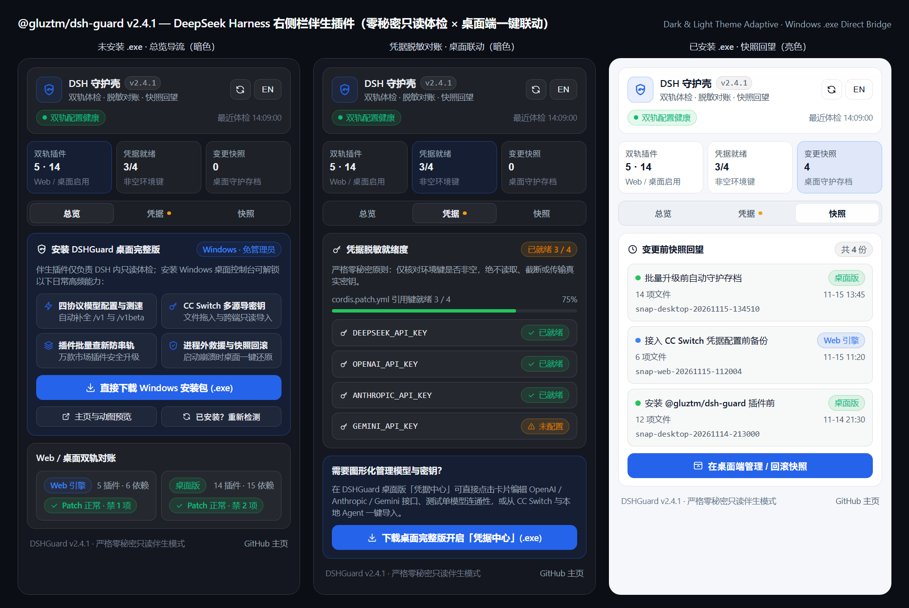
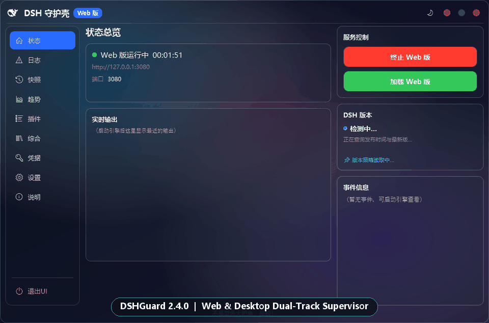

# @gluztm/dsh-guard — Official Companion Plugin for DSHGuard

> **💡 Want the Full Windows Desktop Control Shell? (Companion + Desktop Pairing)**
>
> This plugin is the **cross-platform read-only companion** inside DSH (Web UI right sidebar, Agent tools, and `/guard` command). Full write-side features — **1-click service start/stop, 40+ plugin toggles, CC Switch credential & model library hub, and pre-write backup snapshots with 1-click rollback** — live in the desktop app **[DSHGuard (`DSHGuard.exe`)](https://github.com/gluztm/DSHGuard)**:
> - **[📥 Direct Download Windows Installer `DSHGuard-Setup-2.4.1.exe` (Non-Admin · Bundled Runtime Wizard)](https://github.com/gluztm/DSHGuard/releases/download/2.4.1/DSHGuard-Setup-2.4.1.exe)**
> - When `DSHGuard.exe` is installed on Windows, the sidebar automatically switches to a **1-click Launch DSHGuard** button; otherwise it surfaces a direct installer download card.
>
> <p align="center">
>   
> </p>
> <p align="center">
>   
> </p>

[](../../LICENSE)
[](#install-into-dsh)

[简体中文](README.md) · [DSHGuard Main Repository](../../README.en.md)

`@gluztm/dsh-guard` is the official read-only companion plugin for **[DSHGuard](https://github.com/gluztm/DSHGuard)**. It brings a native **DSH Web UI sidebar panel**, **3 read-only Agent tools**, a **`/guard` slash command**, and a **standalone CLI** that work cross-platform across Windows, macOS, and Linux:

- **Web UI Sidebar & Extension Panel (`lib/client.js`)**: Adapts cleanly to DSH light/dark themes (`--dsw-alias-*` tokens) with an inline EN/ZH toggle:
  - **Dual-Track Manifest Audit**: Checks Web and Desktop `package.json` (`dsh.bundles` vs. `dependencies`), disabled entries, and `cordis.patch.yml` YAML integrity.
  - **Masked Credential Readiness (Zero Secret Read)**: Verifies whether `apiKeyEnv` keys referenced in `cordis.patch.yml` are non-empty inside `.credentials.yaml` — **without ever reading, slicing, logging, or returning secret values**.
  - **Pre-Change Snapshot History**: Lists recent DSHGuard pre-change snapshots stored under `~/.dsh-guard/snapshots/`.
  - **Windows Supervisor Bridge**: On Windows, launches local out-of-band `DSHGuard.exe` in one click for crash rescue, snapshot rollback, or CC Switch import; on macOS/Linux (or when not yet installed), points cleanly to the official GitHub Releases download.
- **Agent Tools & `/guard` Command**:
  - `dsh_guard_status`: Read-only health check and diagnostics across Web & Desktop tracks
  - `dsh_guard_snapshots`: Pre-change snapshot listing filtered by track
  - `dsh_guard_open`: Locate or launch local Windows `DSHGuard.exe`, or return the official release link
  - `/guard [status|snapshots|open]`: Quick slash-command access

> Scoped package note: the unscoped name `dsh-guard` is already taken by another author on npm, so this official companion package uses `@gluztm/dsh-guard` and distributes signed release `.tgz` tarballs directly via [GitHub Release 2.4.1](https://github.com/gluztm/DSHGuard/releases/tag/2.4.1) alongside `DSHGuard-Setup-2.4.1.exe`.

---

## Install into DSH

```powershell
# Add to DSH Web profile (Sidebar UI + Agent tools + /guard)
dsh plugin --profile web add https://github.com/gluztm/DSHGuard/releases/download/2.4.1/dsh-guard-2.4.1.tgz

# Add to DSH Desktop profile
dsh plugin --profile desktop add https://github.com/gluztm/DSHGuard/releases/download/2.4.1/dsh-guard-2.4.1.tgz

# Pair with the Windows Desktop Control Shell (Lifecycle / Credential Vault / Snapshots)
# https://github.com/gluztm/DSHGuard/releases/download/2.4.1/DSHGuard-Setup-2.4.1.exe
```

### Standalone CLI (Node.js >= 18)

```powershell
node packages/dsh-guard/bin/dsh-guard.mjs status
node packages/dsh-guard/bin/dsh-guard.mjs snapshots --json
```

---

## Security & Read-Only Boundaries

- **Zero Secret Leakage**: Only inspects key names and empty/non-empty presence in `.credentials.yaml`. Secret values never enter tool responses, HTTP payloads, or logs.
- **Same-Origin Request Gating**: HTTP routes (`/api/dsh-guard/overview` and `/api/dsh-guard/open`) enforce DSH's `connection.requestRejection` check and never accept arbitrary filesystem path parameters from HTTP callers.
- **Strictly Read-Only**: Never mutates DSH profiles or third-party plugins. Config/plugin mutations, snapshot rollback, and CC Switch import remain isolated in the out-of-band Windows `DSHGuard.exe` supervisor.
