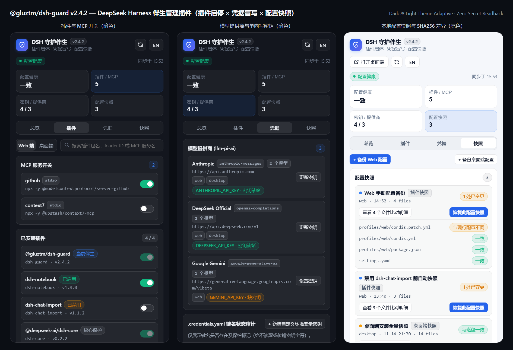

# @gluztm/dsh-guard

> 面向 **DeepSeek Harness (DSH)** 的跨平台运行时底座治理与伴生控制面板（`v2.5.0`）：无需额外安装独立软件，**自动识别当前宿主运行端（桌面端仅看 `desktop`、Web 端仅看 `web`）**，直接在 Web 侧边栏与 CLI 内完成 **健康巡检与断链自愈**、**插件/MCP 启停与超时调优及本地探活**、**工作流场景一键切换**、**按需 `web` ↔ `desktop` 配置无损合并**、**DSH 存储热力可逆回收与脱敏日志雷达**、**上下文与 Skills 可见性治理**、**`.credentials.yaml` 单向盲写** 及 **本地配置快照置顶 + 脱敏审计回滚**。

[English Documentation](./README.en.md) · [GitHub 仓库](https://github.com/gluztm/DSHGuard) · [演进计划书](https://github.com/gluztm/DSHGuard/blob/main/docs/ROADMAP-COMPANION.md) · [Releases](https://github.com/gluztm/DSHGuard/releases/tag/2.4.3)

## 伴生插件内置核心能力

1. **当前运行端自动识别与断链自愈**
   - 自动识别当前 DSH 宿主运行端（桌面端运行自动绑定 `desktop`，Web 端运行自动绑定 `web`），仅聚焦展示并管理当前活跃档案，不扫描 `headless` 或私有目录，彻底消除跨端对比冗余与漂移噪音。
   - 检测 `node_modules` 下失效的符号链接 / NTFS Junction，自动从 `.dsh-module-fallback` 或兄弟档案恢复；若个别断链已无法从本地找到有效源，仍安全完成可修项目并返回清晰清单提示（不再报 HTTP 400）。
2. **插件与 MCP 全生命周期启停、超时微调与本地安全探活**
   - 自动解析 `dsh.bundle.patch` / `cordis.patch.yml` 的 `loaderId` 及 `@deepseek-ai/dsh-mcp-client` 服务，保护 `@deepseek-ai/*` 核心组件与插件自身。
   - 支持无损调节单个 MCP 的 `toolCallTimeoutMs`（`5000`–`600000 ms`），改动前自动保留 `auto-mcp` 快照。
   - 提供只读本地 MCP 探活：HTTP/SSE 型**严格限制仅探测回环地址**（`127.0.0.1` / `localhost` / `::1`）防 SSRF；`stdio` 型校验本地命令与入口脚本文件存在性，不执行第三方命令。
3. **上下文负担体检与 Skills 可见性治理**
   - 汇总当前运行端启用的第三方插件、MCP 工具与常驻提示词（`prompt-inject.md`、`MEMORY.md`、`prompts/*.md`、`system-prompt`）估算基线 Token 与负担等级，提供精简建议。
   - 扫描 `~/.dsh/skills`、`~/.agents/skills` 与插件内置 `SKILL.md`（插件内只读保护），允许对用户技能无损切换 `disable-model-invocation` 与 `user-invocable` 前置元数据开关（保存前比对 SHA256 指纹并保留原换行符/BOM）。
4. **模型提供商巡检与 `.credentials.yaml` 纯单向盲写**
   - 汇总当前运行档案中的 `llm-pi-ai` 协议（`anthropic-messages` / `openai-completions` / `google-generative-ai`）、`baseURL` 与凭据就绪状态；内置 7 套通用主流平台预设快速填入环境变量名。
   - **零明文回显**：保留 `version`、`records`、`*_ACCOUNT_*` 受保护 OAuth 块，响应报文绝不返回密钥字符（通过 `dsh-trust-check` 静态扫描零红线）。
5. **配置快照置顶、SHA256 差异回滚与脱敏审计流水**
   - 备份 `cordis.patch.yml`、`cordis.yml`、`package.json`、`settings.yaml` 至 `~/.dsh/guard-snapshots`（严格排除密钥文件），支持 **📌 置顶保护**（免受自动轮转清理）与白名单一键还原。
   - 每次通过伴生插件完成的变更自动写入 `~/.dsh/guard-state/audit.jsonl`（纯结构化脱敏记录，绝不含密钥值）。
6. **工作流场景套件切换（Loadout Manager）**
   - 内置 `lean-coding`（轻量编码）、`creative-full`（全量创作）、`safe-mode`（安全极简）3 套模式并支持自定义场景保存至 `~/.dsh/guard-state/scenes.json`；切换前支持 L0 Dry-Run 预览，应用前自动保存 `auto-scene` 快照并写入单条聚合审计，同时始终保护 `@deepseek-ai/*` 核心与插件自身。
7. **显式按需双端比对同步、存储热力可逆回收与日志异常雷达（「维护 / Ops」页签）**
   - **按需双端同步**：保持常规运行严格单端聚焦；显式比对 `web` ↔ `desktop` 的模型提供商、MCP 服务与权限区块，无损保留 `!!js` 标签、注释及目标端独有条目（同步前自动快照兜底）。
   - **存储可逆清理**：统计 10 个标准分区占用热力图，强制跳过软链接、置顶快照与一切凭据/密钥备份文件（`.credentials.yaml.bak-*` 等）；通过 Dry-Run 预览后移入 `~/.dsh/guard-recycle/<batchId>` 并支持一键还原。
   - **低 Token 日志雷达**：有界扫描近窗口宿主日志（单文件末尾 256 KB、最多 40 文件），严格脱敏密钥与家目录路径，聚合去重报错签名并给出排查建议。
8. **内置 10 个 Agent 工具 + `/guard` 斜杠命令 + CLI**
   - Agent 工具：`dsh_guard_status`、`dsh_guard_context_audit`、`dsh_guard_mcp_probe`、`dsh_guard_scenes`、`dsh_guard_profile_diff`、`dsh_guard_storage_audit`、`dsh_guard_log_radar`、`dsh_guard_snapshots`、`dsh_guard_backup`、`dsh_guard_open`
   - 斜杠命令：`/guard`、`/guard status`、`/guard context`、`/guard mcp`、`/guard scenes`、`/guard diff`、`/guard storage`、`/guard logs`、`/guard snapshots`、`/guard backup [web|desktop]`、`/guard open`
   - CLI：`dsh-guard status|context|mcp-probe|scenes|diff|storage|logs|snapshots|backup|repair|audit|open`（全面支持 `--json`）

---

## 技术与安全边界说明（何时需要原生桌面端）

本伴生插件已经覆盖当前运行端的日常巡检、扩展与上下文治理、MCP 本地探活、密钥盲写与配置快照回滚需求；以下能力由于操作系统或安全架构限制，**无法在运行中的 DSH Node 宿主插件内部安全实现**，仅在独立进程外原生程序 **[DSHGuard Desktop (Windows)](https://github.com/gluztm/DSHGuard/releases/tag/2.4.3)** 中提供：

| 能力领域 | 伴生插件内置能力 | 仅独立原生桌面端提供（及原因） |
| :--- | :--- | :--- |
| **插件包生命周期** | 安全切换插件/MCP/Skills 开关、超时调优、本地探活、断链修复 | **全新安装 / 彻底卸载 / 强杀锁死进程**：运行时在宿主进程内删除或重装 `node_modules` 会撕裂已加载模块并触发文件占用锁死；且插件不应持有远端包拉取与进程强杀权。 |
| **凭据安全与导入** | `.credentials.yaml` 键名审计 + 单向盲写 | **明文编辑 / Windows DPAPI 硬件加密库 / CC Switch 导入**：Web 插件拥有前端请求能力，依据安全合规禁止反向回显明文；DPAPI 与跨工具配置迁移依赖 Windows 原生安全 API。 |
| **系统级备份恢复** | YAML/JSON 配置文件实时对比、置顶保护与白名单回滚 | **整包扩展目录 ZIP 归档 + 主程序崩溃带外恢复**：涵盖整套 `node_modules` 与主程序启停的重型恢复必须脱离 DSH 宿主进程独立调度。 |

- 若本机已安装 Windows 原生桌面端，插件右上角会自动显示「打开桌面端」快捷入口。
- 仅需要上述带外桌面功能时，可在 [GitHub Release v2.4.3](https://github.com/gluztm/DSHGuard/releases/tag/2.4.3) 获取 [DSHGuard-Setup-2.4.3.exe](https://github.com/gluztm/DSHGuard/releases/download/2.4.3/DSHGuard-Setup-2.4.3.exe)（源码可审计，基于 .NET 10 + WPF 原生构建）。

## 许可协议

GPL-3.0 © gluztm
